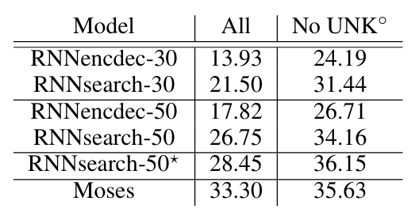
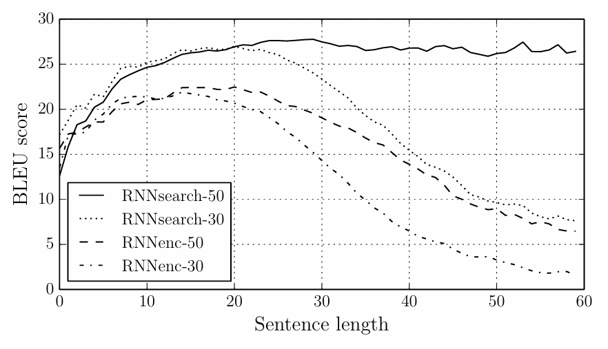
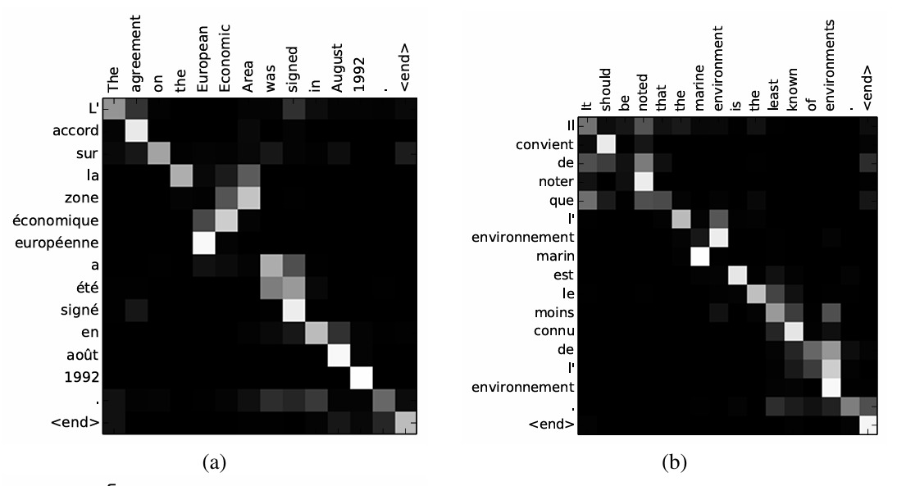

# [Paper Review] Neural Machine Translation by Jointly Learning to Align and Translate

> **Authors:** Dzmitry Bahdanau, KyungHyun Cho, Yoshua Bengio\
> **Institutions:** Jacobs University Bremen, Université de Montréal\
> **Publication:** ICLR 2015\
> **Link:** https://arxiv.org/abs/1409.0473

## Abstract & Introduction

Previous machine translation systems consisted of many smaller subcomponents. A new approach called _neural machine translation_ uses a single neural network to read a sentence and output a translation. Most neural machine translation models are encoder-decoders where a sentence is transformed into a _fixed-length_ encoding vector, from which the translation is outputted. The problem with this approach is that it is difficult to compress all the information into a fixed-length vector for very long sentences. 

To address this issue, the paper proposes an "attention" mechanism that for each target word, identifies the most relevant words in the original sentence. Each new target word is produced based on its "context vectors" as well as the previously generated target words.

## Method 

### Decoder

The decoder uses a different context vector for every target position:

```math
p(y_i\mid y_1,\ldots,y_{i-1},x)=g(y_{i-1},s_i,c_i).
```

```math
s_i=f(s_{i-1},y_{i-1},c_i).
```

Here $`s_i`$ is the decoder state, and $`c_i`$ retrieves information from the source annotations:

```math
c_i=\sum_{j=1}^{T_x}\alpha_{ij}h_j.
```

The alignment network scores each annotation using the previous decoder state. Softmax normalizes these scores over source positions:

```math
e_{ij}=a(s_{i-1},h_j),
\qquad
\alpha_{ij}=\frac{\exp(e_{ij})}{\sum_{k=1}^{T_x}\exp(e_{ik})}.
```

Here $`i`$ indexes target words and $`j`$ indexes source words. The alignment score asks how useful source position $`j`$ is for producing target word $`i`$. Appendix A specifies the additive scoring function:

```math
a(s_{i-1},h_j)=v_a^\top\tanh(W_as_{i-1}+U_ah_j).
```

Parameters are shared across positions. The weights sum to one, allowing attention to several relevant words rather than one hard alignment. Because this weighted sum is differentiable, alignment and translation are learned jointly without annotated alignments.

The dimension of $`c_i`$ remains fixed, but its contents change at each step. Attention removes the requirement that one unchanged vector carry the entire sentence.

### Encoder: a Bidirectional RNN 

Conventional RNN-based encoders have the limitation that each word annotation describes only the preceding works and not the following words. Thus a bidirectional RNN is used; one RNN reads the sequence in the give order and another in the reverse order, and the two sequences of hidden states are concatenated. Due to the RNN's tendency to better represent recent information, each word's annotation will be focused on the words around it. 

### Experiments 

The models were training on the WMT 2014 English-to-French translation dataset. A 30,000-word vocabulary was used for each language. Four models were trained. **RNNencdec** models are conventional encoder-decoders while **RNNsearch** utilizes the attention mechanism. The suffixes "30" and "50" indicate the maximum training sentence lengths. 


## Results

<p align="center">
  
</p>

<p align="center"><em>Table 1. Translation performances, measured in BLEU score.</em></p>

Both RNNsearch-30 and RNNsearch-50 significantly outperform their RNNencdec counterparts. 

<p align="center">
  
</p>

<p align="center"><em>Figure 2. The BLEU scores of models varying with sentence length.</em></p>

Attention substantially reduces the degradation seen in the fixed-vector model as sentences grow longer. RNNsearch-30 even outperforms RNNencdec-50 overall.

<p align="center">
  
</p>

<p align="center"><em>Figure 3. Learned alignment heatmaps. The x-axis and y-axis correspond to the source sentence (English) and generated translation (French) respectively. </em></p>

A bright cell represents a large attention weight for a source–target pair. Diagonal patterns indicate similar word order; off-diagonal patterns can reflect reordering. Soft alignment also lets a target word draw on multiple source words.

