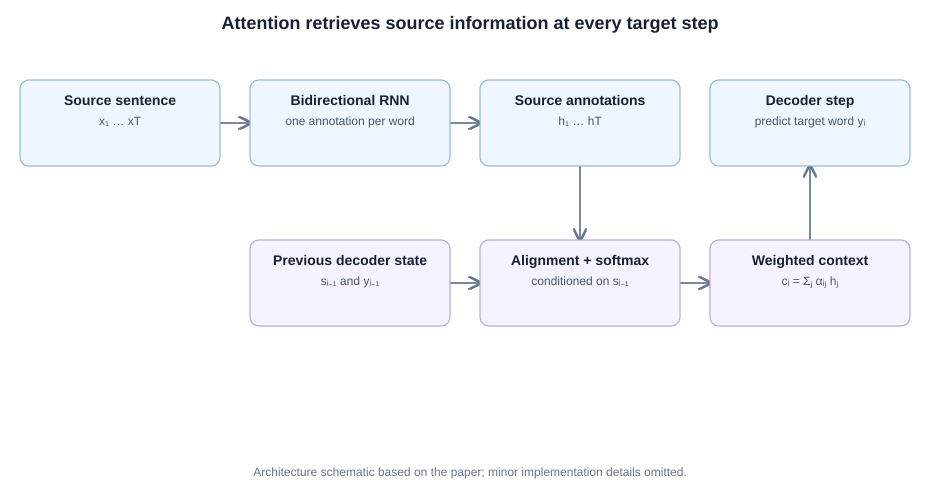
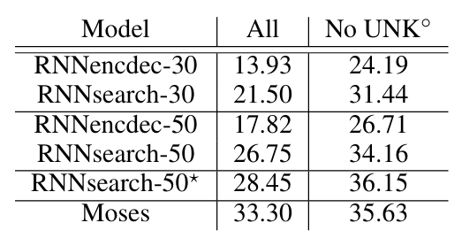
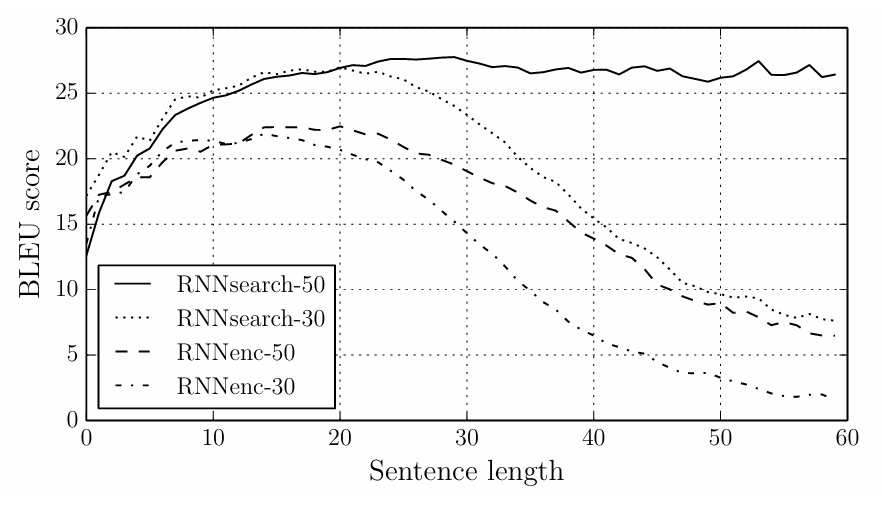
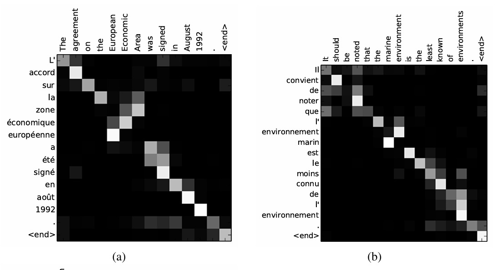

# [Paper Review] Neural Machine Translation by Jointly Learning to Align and Translate

> **Authors:** Dzmitry Bahdanau, KyungHyun Cho, Yoshua Bengio\
> **Institutions:** Jacobs University Bremen, Université de Montréal\
> **Publication:** ICLR 2015\
> **Link:** https://arxiv.org/abs/1409.0473

## Abstract & Introduction

Compressing an entire sentence into one vector makes early neural translation models struggle with long inputs. Bahdanau et al. replace that bottleneck with attention: a bidirectional encoder retains a representation at every source position, and the decoder learns which positions matter for each target word. Alignment and translation are trained together, improving English-to-French translation and making the learned correspondences visible.

## Methods

<p align="center">
  
</p>

<p align="center"><em>Attention forms a new weighted context for each generated word. Schematic based on the paper.</em></p>

### Decoder

The decoder uses a different context vector for every target position:

```math
p(y_i\mid y_1,\ldots,y_{i-1},x)=g(y_{i-1},s_i,c_i).
```

```math
s_i=f(s_{i-1},y_{i-1},c_i).
```

Here $`s_i`$ is the decoder state, and $`c_i`$ retrieves information from the source annotations:

```math
c_i=\sum_{j=1}^{T_x}\alpha_{ij}h_j.
```

The alignment network scores each annotation using the previous decoder state. Softmax normalizes these scores over source positions:

```math
e_{ij}=a(s_{i-1},h_j),
\qquad
\alpha_{ij}=\frac{\exp(e_{ij})}{\sum_{k=1}^{T_x}\exp(e_{ik})}.
```

Here $`i`$ indexes target words and $`j`$ indexes source words. The alignment score asks how useful source position $`j`$ is for producing target word $`i`$. Appendix A specifies the additive scoring function:

```math
a(s_{i-1},h_j)=v_a^\top\tanh(W_as_{i-1}+U_ah_j).
```

Parameters are shared across positions. The weights sum to one, allowing attention to several relevant words rather than one hard alignment. Because this weighted sum is differentiable, alignment and translation are learned jointly without annotated alignments.

The dimension of $`c_i`$ remains fixed, but its contents change at each step. Attention removes the requirement that one unchanged vector carry the entire sentence.

### Encoder: a Bidirectional RNN 

Conventional RNN-based encoders have the limitation that each word annotation describes only the preceding words and not the following words. Thus a bidirectional RNN is used; one RNN reads the sequence in the given order and another in the reverse order, and the two sequences of hidden states are concatenated. Due to the RNN's tendency to better represent recent information, each word's annotation will be focused on the words around it. 

### Experiments 

The models were trained on the WMT 2014 English-to-French translation dataset. A 30,000-word vocabulary was used for each language. Four models were trained. **RNNencdec** models are conventional encoder-decoders while **RNNsearch** utilizes the attention mechanism. The suffixes "30" and "50" indicate the maximum training sentence lengths.

## Results

### Translation quality

<p align="center">
  
</p>

_Table 1._ Attention improves both encoder–decoder baselines; the longer-trained model exceeds Moses on the subset without unknown words.

### Sentence length and alignment

| Evidence | Finding |
| --- | --- |
|  | Attention substantially reduces degradation on long sentences |
|  | Soft alignments capture local correspondences and word reordering |

_Figures 2–3._ The visualizations support the motivation for retrieving a different source context at each decoder step.
