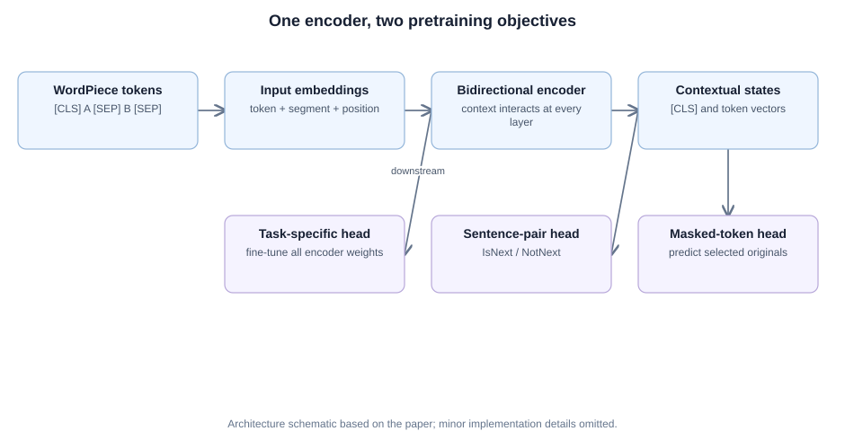

# [Paper Review] BERT: Pre-training of Deep Bidirectional Transformers for Language Understanding

> **Authors:** Jacob Devlin, Ming-Wei Chang, Kenton Lee, Kristina Toutanova\
> **Institutions:** Google AI Language\
> **Publication:** NAACL 2019\
> **Link:** [https://arxiv.org/abs/1810.04805](https://arxiv.org/abs/1810.04805)

## Abstract & Introduction

A word's meaning depends on what comes before and after it. BERT pretrains a deeply bidirectional Transformer using masked language modeling and next sentence prediction, then fine-tunes the same encoder for different language tasks. This simple transfer procedure improves eleven NLP benchmarks and greatly reduces the need to design a separate architecture for each task.

## Methods

<p align="center">
  
</p>

<p align="center"><em>BERT shares an encoder across masked-token and sentence-pair pretraining. Schematic based on the paper.</em></p>

### Model architecture and input representations

BERT uses the encoder from the original Transformer. BERT-Base has 12 layers, hidden width 768, and 12 attention heads, with 110 million parameters. BERT-Large has 24 layers, hidden width 1,024, and 16 heads, with 340 million parameters.

The input can contain one text span or a pair. A [CLS] token is added at the beginning, and [SEP] tokens mark boundaries. The final [CLS] representation is used for sequence classification. A question and passage can be packed together so that their tokens interact directly through self-attention.

Each input representation sums three learned embeddings:

```math
E_i=E_{\mathrm{token},i}+E_{\mathrm{segment},i}+E_{\mathrm{position},i}.
```

WordPiece tokenization uses a 30,000-token vocabulary. Segment embeddings distinguish the two packed spans, while position embeddings encode sequence order. In the paper, a “sentence” can be a contiguous span of text rather than a complete grammatical sentence.

### Masked language modeling

A conventional bidirectional language model could see the token it is supposed to predict. BERT avoids this problem by selecting 15% of input positions for prediction. Of the selected tokens, 80% are replaced with [MASK], 10% with a random token, and 10% remain unchanged.

The objective predicts the original tokens at all selected positions:

```math
\mathcal L_{\mathrm{MLM}}
=-\sum_{i\in M}\log p_\theta(x_i\mid\widetilde x).
```

Here $M$ is the selected position set and $\widetilde x$ is the corrupted input. Only selected positions contribute to this loss. Random replacements and unchanged tokens reduce the mismatch caused by [MASK] appearing during pretraining but not ordinary fine-tuning.

Because prediction uses the corrupted sequence, the encoder can attend bidirectionally without having access to the original answers at replaced positions.

### Next sentence prediction

The second objective classifies whether a second span follows the first in the source document. Half of the training pairs are genuine continuations; the other half use a randomly sampled span. A classifier over [CLS] predicts _IsNext_ or _NotNext_.

This next sentence prediction (NSP) objective trains a representation of the relationship between paired inputs. The total pretraining loss combines MLM and NSP.

### Pretraining and fine-tuning

Pretraining uses BooksCorpus, containing 800 million words, and English Wikipedia, containing 2.5 billion words. Document boundaries are retained so that training examples can contain long contiguous passages.

The models train for one million steps with batches of 256 sequences. Most steps use sequences of length 128, followed by length 512 for the final 10%. This reduces the cost of pretraining while still training the longer position embeddings.

Fine-tuning initializes the encoder from these weights and updates all parameters. Sequence classification attaches an output layer to [CLS]. Token classification attaches outputs to individual token states. Each downstream task produces its own fine-tuned model.

## Results

### Language understanding

| Benchmark | Model / setting | Test score ↑ |
| --- | --- | ---: |
| GLUE, official benchmark | BERT-Large | 80.5 |
| SQuAD v1.1, F1 | BERT-Large, single + TriviaQA | 91.8 |
| SQuAD v1.1, F1 | BERT-Large, ensemble + TriviaQA | 93.2 |
| SQuAD v2.0, F1 | BERT-Large, single | 83.1 |
| SWAG, accuracy | OpenAI GPT | 78.0 |
| SWAG, accuracy | BERT-Large | 86.3 |

_Selected results from the abstract and Tables 2–4._ BERT transfers to both sentence-level and token-level tasks; the strongest SQuAD v1.1 result also uses ensembling and TriviaQA adaptation.

### Pretraining objectives

| BERT-Base variant | MNLI-m accuracy ↑ | QNLI accuracy ↑ | SQuAD dev F1 ↑ |
| --- | ---: | ---: | ---: |
| MLM + NSP | 84.4 | 88.4 | 88.5 |
| MLM, no NSP | 83.9 | 84.9 | 87.9 |
| Left-to-right LM, no NSP | 82.1 | 84.3 | 77.8 |
| Left-to-right LM + BiLSTM, no NSP | 82.1 | 84.1 | 84.9 |

_Selected development results from Table 5._ Bidirectional pretraining is particularly useful for answer-span prediction; adding a BiLSTM only at fine-tuning does not recover the full gain.
