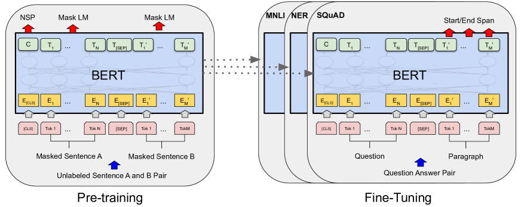

# [Paper Review] BERT: Pre-training of Deep Bidirectional Transformers for Language Understanding

> **Authors:** Jacob Devlin, Ming-Wei Chang, Kenton Lee, Kristina Toutanova\
> **Institutions:** Google AI Language\
> **Publication:** NAACL 2019\
> **Link:** [https://arxiv.org/abs/1810.04805](https://arxiv.org/abs/1810.04805)

*Draft — follows the paper's main section order; appendices are condensed.*

## Abstract

Bidirectional pretraining supplies transferable representations.

## 1 Introduction

Masked prediction enables both left and right context during pretraining. Corrupting inputs prevents trivial prediction from the target token itself.

## 2 Related Work

### 2.1 Unsupervised Feature-based Approaches

ELMo transfers contextual features into task-specific models.

### 2.2 Unsupervised Fine-tuning Approaches

GPT transfers pretrained parameters through fine-tuning.

### 2.3 Transfer Learning from Supervised Data

Supervised pretraining is another route to transferable representations.

## 3 BERT

A bidirectional encoder consumes summed token, segment, and position embeddings. [CLS] supplies a sequence-level output, while [SEP] separates packed segments. BERT-Base uses 12 layers, hidden width 768, and 12 attention heads.

<p align="center">
  <!-- TODO: Add ./images/figure2.png, then uncomment the image below. -->
  <!--  -->
</p>

<p align="center"><em>Figure 2. Token, segment, and position embeddings are summed. [Image to add]</em></p>

### 3.1 Pre-training BERT

**Masked LM.** Select 15% of tokens; replace selected tokens with [MASK], random tokens, or unchanged tokens in an 80/10/10 ratio. Predict originals at selected positions. Supervise every selected position, including unchanged tokens; 15% denotes selection, not [MASK] replacement.

```math
\mathcal L_{\mathrm{MLM}}=-\sum_{i\in M}\log p_\theta(x_i\mid\widetilde{x}).
```

**Next sentence prediction.** Classify genuine versus randomly paired continuations, sampled equally. BooksCorpus and Wikipedia supply pretraining examples.

### 3.2 Fine-tuning BERT

Attach task-specific outputs and update all parameters. Use [CLS] for classification and token outputs for tagging.

<p align="center">
  <!-- TODO: Add ./images/figure1.png, then uncomment the image below. -->
  <!--  -->
</p>

<p align="center"><em>Figure 1. Shared pretrained encoder adapted to different downstream tasks. [Image to add]</em></p>

## 4 Experiments

### 4.1 GLUE

Evaluate sentence classification and sentence-pair understanding. BERT-Large's official GLUE score is 80.5; Table 1 excludes WNLI from its average.

<p align="center">
  <!-- TODO: Add ./images/table1.png, then uncomment the image below. -->
  <!--  -->
</p>

<p align="center"><em>Table 1. GLUE test results for BERT and baseline systems. [Image to add]</em></p>

### 4.2 SQuAD v1.1

Predict answer-span endpoints using separate start/end scores over passage tokens.

### 4.3 SQuAD v2.0

Also recognize unanswerable questions by comparing the best span against a [CLS]-based no-answer score.

### 4.4 SWAG

Score each context–continuation pair and select among four choices.

## 5 Ablation Studies

### 5.1 Effect of Pre-training Tasks

Compare bidirectionality and NSP ablations. Removing NSP reduces several scores; replacing masked pretraining with left-to-right modeling particularly hurts token-level question answering.

<p align="center">
  <!-- TODO: Add ./images/table5.png, then uncomment the image below. -->
  <!--  -->
</p>

<p align="center"><em>Table 5. Pretraining-objective ablations with the BERT-Base architecture. [Image to add]</em></p>

### 5.2 Effect of Model Size

Larger models improve downstream results, including tasks with few labeled examples.

### 5.3 Feature-based Approach with BERT

Test frozen features on named-entity recognition as an alternative to full fine-tuning.

## 6 Conclusion

Pretraining reduces task-specific architectural engineering.

## Appendix notes

Masking alternatives, training schedules, and fine-tuning details complement the main comparisons.
