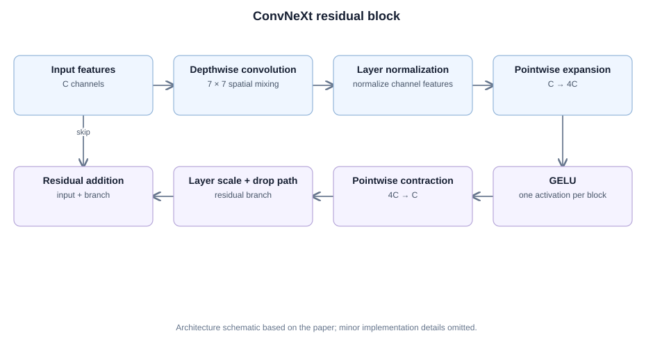

# [Paper Review] A ConvNet for the 2020s

> **Authors:** Zhuang Liu, Hanzi Mao, Chao-Yuan Wu, Christoph Feichtenhofer, Trevor Darrell, Saining Xie\
> **Institutions:** Facebook AI Research (FAIR), University of California, Berkeley\
> **Publication:** CVPR 2022\
> **Link:** [https://arxiv.org/abs/2201.03545](https://arxiv.org/abs/2201.03545)

## Abstract & Introduction

How much of the vision Transformer's advantage comes from attention, and how much comes from everything around it? ConvNeXt updates a ResNet with modern training, depthwise convolutions, inverted bottlenecks, larger kernels, and a simpler block design. The resulting convolutional backbone matches or exceeds Swin on classification and dense prediction, showing how much room remained in conventional ConvNets.

## Methods

<p align="center">
  
</p>

<p align="center"><em>Spatial mixing and channel mixing are separated within a residual block. Schematic based on the paper.</em></p>

### Training techniques

The first change strengthens the training recipe before modifying the network. Training runs for 300 epochs using AdamW, modern augmentation, and regularization, including Mixup, CutMix, RandAugment, random erasing, and stochastic depth.

This raises the ResNet-50 baseline from 76.1% to 78.8% ImageNet top-1 accuracy. A substantial part of the initial difference therefore comes from training.

### Macro design

The stage-depth ratio is changed from ResNet-50's $(3,4,6,3)$ to $(3,3,9,3)$, allocating more blocks to the third stage. The original convolution and max-pooling stem is replaced with a $4\times4$ stride-four convolution. This produces non-overlapping patch-like features while retaining a convolutional implementation.

### Depthwise convolutions and inverted bottlenecks

The spatial convolution becomes a depthwise convolution, applying one spatial filter per channel. Channel mixing is handled separately by pointwise transformations. The network width is adjusted to recover capacity.

The residual block also adopts an inverted bottleneck. Its intermediate representation expands to four times the input width before contracting again, resembling the channel expansion in a Transformer's MLP.

### Larger kernels

The depthwise convolution moves before the channel expansion, where it is cheaper to apply. Its kernel grows from $3\times3$ to $7\times7$, increasing the region mixed by each block. Increasing the kernel further gives little additional benefit in the reported experiment.

### Micro design

ReLU is replaced with GELU. Extra activation and normalization layers are removed, leaving a block with one activation between its pointwise transformations. Layer normalization replaces batch normalization, and separate downsampling layers connect the stages.

A simplified block is

```math
x_{\mathrm{out}}
=x+\mathrm{PW}_{\mathrm{contract}}\left(
\mathrm{GELU}\left(
\mathrm{PW}_{\mathrm{expand}}\left(
\mathrm{LN}(\mathrm{DWConv}_{7\times7}(x))
\right)\right)\right).
```

The implementation also includes layer scaling and stochastic depth. These changes are evaluated along a cumulative modernization path, so each measured gain depends on the modifications already made.

### Experiments

ConvNeXt-T, S, B, L, and XL vary stage depths and channel widths. Classification experiments use ImageNet-1K, with an additional setting that pretrains on ImageNet-22K. Downstream experiments replace the backbone in established detection and segmentation frameworks.

## Results

### ImageNet-1K classification

| Model | Pretraining data | Input | Top-1 accuracy ↑ |
| --- | --- | --- | ---: |
| Swin-T | ImageNet-1K | 224² | 81.3 |
| ConvNeXt-T | ImageNet-1K | 224² | 82.1 |
| Swin-B | ImageNet-1K | 224² | 83.5 |
| ConvNeXt-B | ImageNet-1K | 224² | 83.8 |
| Swin-L | ImageNet-22K | 384² | 87.3 |
| ConvNeXt-L | ImageNet-22K | 384² | 87.5 |
| ConvNeXt-XL | ImageNet-22K | 384² | 87.8 |

_Selected results from Table 1._ ConvNeXt is competitive across model sizes under matched pretraining and resolution settings.

### Constant-resolution backbones

| Model | Parameters | GFLOPs | ImageNet top-1 ↑ |
| --- | ---: | ---: | ---: |
| ViT-S | 22M | 4.6 | 79.8 |
| Isotropic ConvNeXt-S | 22M | 4.3 | 79.7 |
| ViT-B | 87M | 17.6 | 81.8 |
| Isotropic ConvNeXt-B | 87M | 16.9 | 82.0 |
| ViT-L | 304M | 61.6 | 82.6 |
| Isotropic ConvNeXt-L | 306M | 59.7 | 82.6 |

_Selected results from Table 2, ImageNet-1K at 224²._ The updated block remains competitive when the feature hierarchy is removed.

### COCO detection and instance segmentation

| Framework / backbone | Box AP ↑ | Mask AP ↑ |
| --- | ---: | ---: |
| Mask R-CNN / Swin-T | 46.0 | 41.6 |
| Mask R-CNN / ConvNeXt-T | 46.2 | 41.7 |
| Cascade Mask R-CNN / ResNet-50 | 46.3 | 40.1 |
| Cascade Mask R-CNN / Swin-T | 50.4 | 43.7 |
| Cascade Mask R-CNN / ConvNeXt-T | 50.4 | 43.7 |

_Selected results from Table 3, 3× schedules._ Classification gains transfer to dense prediction, where ConvNeXt-T matches or slightly exceeds Swin-T in these comparisons.
