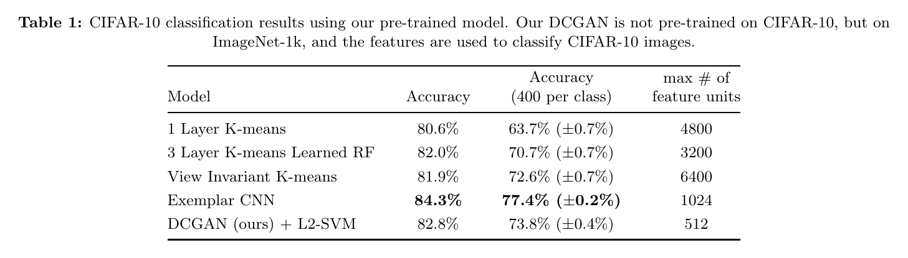
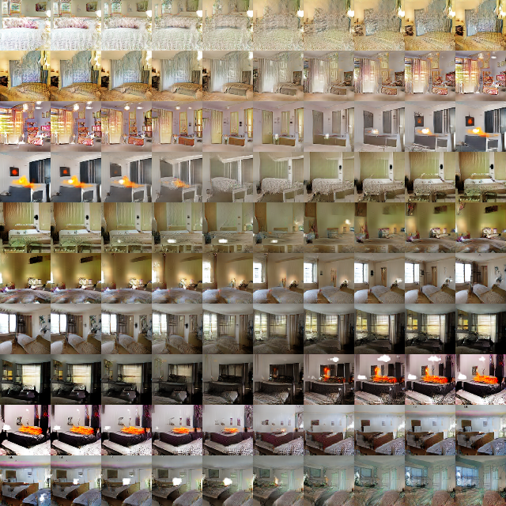
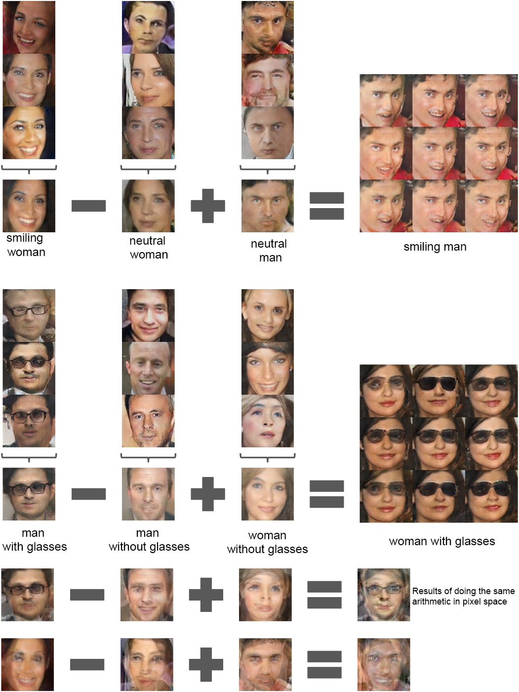

# [Paper Review] Unsupervised Representation Learning with Deep Convolutional Generative Adversarial Networks

> **Authors:** Alec Radford, Luke Metz, Soumith Chintala\
> **Institutions:** indico Research, Facebook AI Research\
> **Publication:** ICLR 2016\
> **Link:** https://arxiv.org/abs/1511.06434

## Abstract & Introduction
Despite the huge adoption of supervised learning with convolutional neural networks (CNNs) in computer vision, unsupervised learning has received comparatively little attention. This paper proposes an unsupervised learning model called deep convolutional generative adversarial networks (DCGANs) that learns image representations that can later be used for supervised vision tasks. 

The DCGAN ultimately improved the original GAN and made training significantly more stable. 

## Methods
Scaling GANs with conventional CNN architectures proved difficult, especially due to unstable training. The paper adopts four architectural modifications:

1. _The all-convolutional net_. Replace deterministic pooling with strided convolutions in the discriminator and fractionally strided convolutions (transposed convolutions) in the generator, allowing learned spatial downsampling and upsampling.
2. _Removing fully connected hidden layers_. Removing intermediate fully connected layers supports deeper architectures. The generator still projects the input noise into an initial spatial representation.
3. _Batch normalization_. Batch normalization (Ioffe & Szegedy, 2015) stabilizes learning and helps gradient flow. It is omitted from the generator output layer and discriminator input layer to avoid instability.
4. _Activation functions_. Use ReLU in the generator, except for its Tanh output, and LeakyReLU in the discriminator. The original GAN's discriminator used maxout.

  

  *Figure 1. The generator maps a noise vector to a 64 × 64 image.*

DCGAN was trained on LSUN bedrooms, ImageNet-1k, and a Faces dataset. Training uses Adam with a learning rate of 0.0002 and β₁ = 0.5; reducing β₁ from 0.9 helped stabilize training.

## Results

### Useful discriminator representations

ImageNet-trained discriminator features, paired with a linear SVM, achieve **82.8% accuracy on CIFAR-10**. This exceeds the reported K-means baselines but falls below Exemplar CNN's 84.3%.

  

  *Table 1. Classification evaluates whether the learned features transfer to another dataset.*

### Smooth latent interpolation

Interpolating between latent vectors produces gradual changes in bedroom structure, suggesting meaningful organization of the latent space.

  

  *Figure 4. Latent interpolation produces smooth visual transitions.*

### Semantic vector arithmetic

Arithmetic on averaged latent vectors changes visual attributes, illustrating semantic structure in the generator's input space.

  

  *Figure 7. Vector arithmetic manipulates visual concepts.*

