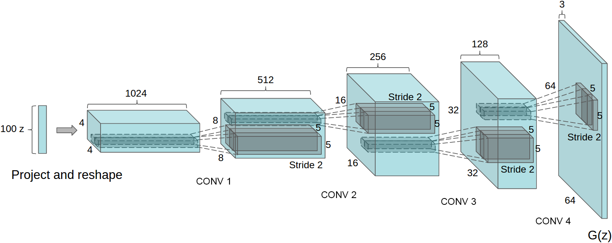

# [Paper Review] Unsupervised Representation Learning with Deep Convolutional Generative Adversarial Networks

> **Authors:** Alec Radford, Luke Metz, Soumith Chintala\
> **Institutions:** indico Research, Facebook AI Research\
> **Publication:** ICLR 2016\
> **Link:** https://arxiv.org/abs/1511.06434

## Abstract & Introduction  
Despite the huge adoption of supervised learning with convolutional neural networks (CNNs) in computer vision, unsupervised learning has received comparatively little attention. This paper proposes an unsupervised learning model called deep convolutional generative adversarial networks (DCGANs) that builds good image representations that can be used for various supervised vision tasks later on. 

## Methods 
There have been several attempts to combine CNNs with generative adversarial networks (GANs), all of which were unsuccessful, especially due to unstable training. The paper's approach applied four modifications: 
1. _The convolutional net_. Instead of deterministic pooling functions with strided convolutions, we let the network learn its own spatial downsampling.
2. _Removing fully connected layers_. The removal of fully connected hidden layers helped achieve deeper architectures. 
3. _Batch normalization_. The use of batch normalization (Ioffe & Szegedy, 2015) greatly stabilized learning generally. Not applying batchnorm to the generator output layer and the discriminator input layer further improved performance.
4. _ReLU activation function_. The use of ReLU and LeakyRelu activation functions were superior to the maxout functions used in the orignial Goodfellow paper. 

## Results 
