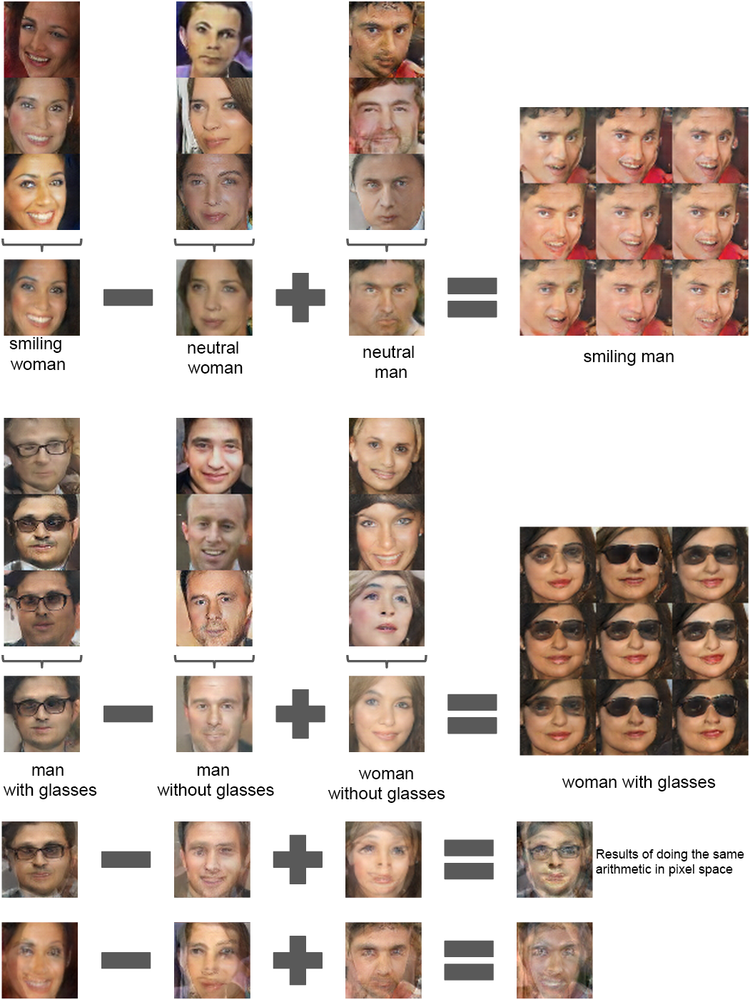

# [Paper Review] Unsupervised Representation Learning with Deep Convolutional Generative Adversarial Networks

> **Authors:** Alec Radford, Luke Metz, Soumith Chintala\
> **Institutions:** indico Research, Facebook AI Research\
> **Publication:** ICLR 2016\
> **Link:** https://arxiv.org/abs/1511.06434

## Abstract & Introduction

GANs could generate images, but training them with deep convolutional networks was unstable. DCGAN establishes a practical architecture using learned spatial resampling, batch normalization, and carefully chosen activations. Its generator learns a structured latent space, while its discriminator supplies transferable visual features—making adversarial generation useful for representation learning as well as image synthesis.

## Methods

  

<em>Figure 1. The DCGAN generator architecture. From the <a href="https://arxiv.org/abs/1511.06434">original paper</a>.</em>

Scaling GANs with conventional CNN architectures proved difficult, especially due to unstable training. The paper adopts four architectural modifications:

1. _The all-convolutional net_. Replace deterministic pooling with strided convolutions in the discriminator and fractionally strided convolutions (transposed convolutions) in the generator, allowing learned spatial downsampling and upsampling.
2. _Removing fully connected hidden layers_. Removing intermediate fully connected layers supports deeper architectures. The generator still projects the input noise into an initial spatial representation.
3. _Batch normalization_. Batch normalization (Ioffe & Szegedy, 2015) stabilizes learning and helps gradient flow. It is omitted from the generator output layer and discriminator input layer to avoid instability.
4. _Activation functions_. Use ReLU in the generator, except for its Tanh output, and LeakyReLU in the discriminator. The original GAN's discriminator used maxout.

DCGAN was trained on LSUN bedrooms, ImageNet-1k, and a Faces dataset. Training uses Adam with a learning rate of 0.0002 and β₁ = 0.5; reducing β₁ from 0.9 helped stabilize training.

## Results

### Transfer to CIFAR-10

| Representation | Accuracy ↑ | Accuracy, 400 labels/class ↑ |
| --- | ---: | ---: |
| 1-layer K-means | 80.6% | 63.7% |
| 3-layer K-means, learned receptive fields | 82.0% | 70.7% |
| View-invariant K-means | 81.9% | 72.6% |
| Exemplar CNN | 84.3% | 77.4% |
| DCGAN + linear SVM | 82.8% | 73.8% |

_Selected means from Table 1._ Features learned on ImageNet transfer to CIFAR-10, exceeding the K-means baselines while trailing Exemplar CNN.

### SVHN with 1,000 labels

| Method | Test error ↓ |
| --- | ---: |
| M1+M2 | 36.02% |
| SWWAE without dropout | 27.83% |
| SWWAE with dropout | 23.56% |
| DCGAN + linear SVM | 22.48% |

_Selected results from Table 2._ The discriminator also learns useful features when only a small labeled set is available.

### Learned representations

| Evidence | Finding |
| --- | --- |
|  | Learned filters respond to recognizable structures such as beds |
|  | Nearby latent vectors decode into gradual changes in room layout |
|  | Arithmetic on averaged codes changes visual attributes |

_Figures 4–5 and 7._ The generator and discriminator learn structure beyond the binary training label.
