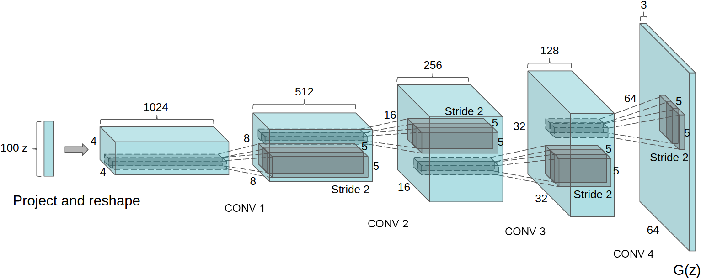
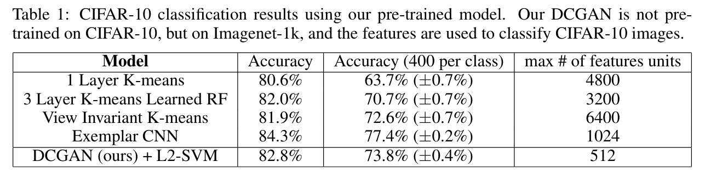
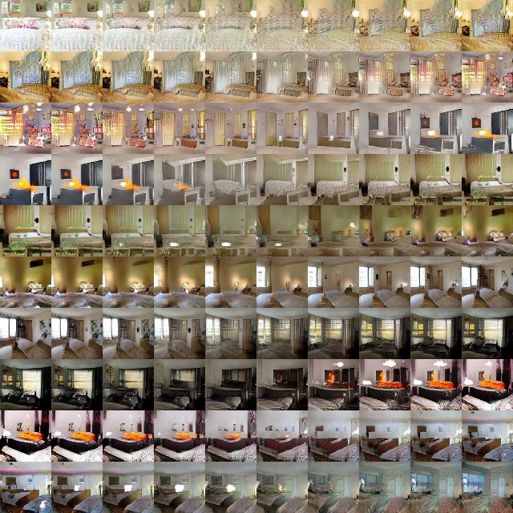

# [Paper Review] Unsupervised Representation Learning with Deep Convolutional Generative Adversarial Networks

> **Authors:** Alec Radford, Luke Metz, Soumith Chintala\
> **Institutions:** indico Research, Facebook AI Research\
> **Publication:** ICLR 2016\
> **Link:** [https://arxiv.org/abs/1511.06434](https://arxiv.org/abs/1511.06434)

*Draft — follows the paper's main section order; appendices are condensed.*

## Abstract

DCGAN studies stable convolutional GAN architectures and the representations learned without labels.

## 1 Introduction
Despite the huge adoption of supervised learning with convolutional neural networks (CNNs) in computer vision, unsupervised learning has received comparatively little attention. This paper proposes an unsupervised learning model called deep convolutional generative adversarial networks (DCGANs) that learns image representations that can later be used for supervised vision tasks. 

The DCGAN ultimately improved the original GAN and made training significantly more stable. 

## 2 Related Work

### 2.1 Representation Learning from Unlabeled Data

Compare adversarially learned features with clustering and autoencoder-based representations.

### 2.2 Generating Natural Images

Position DCGAN among generative models and earlier GANs.

### 2.3 Visualizing the Internals of CNNs

Feature visualization motivates examining both the discriminator and generator.

## 3 Approach and Model Architecture
Scaling GANs with conventional CNN architectures proved difficult, especially due to unstable training. The paper adopts four architectural modifications:

1. _The all-convolutional net_. Replace deterministic pooling with strided convolutions in the discriminator and fractionally strided convolutions (transposed convolutions) in the generator, allowing learned spatial downsampling and upsampling.
2. _Removing fully connected hidden layers_. Removing intermediate fully connected layers supports deeper architectures. The generator still projects the input noise into an initial spatial representation.
3. _Batch normalization_. Batch normalization (Ioffe & Szegedy, 2015) stabilizes learning and helps gradient flow. It is omitted from the generator output layer and discriminator input layer to avoid instability.
4. _Activation functions_. Use ReLU in the generator, except for its Tanh output, and LeakyReLU in the discriminator. The original GAN's discriminator used maxout.

  

<em>Figure 1. The generator maps a noise vector to a 64 × 64 image.</em>

## 4 Details of Adversarial Training

DCGAN was trained on LSUN bedrooms, ImageNet-1k, and a Faces dataset. Training uses Adam with a learning rate of 0.0002 and β₁ = 0.5; reducing β₁ from 0.9 helped stabilize training.

### 4.1 LSUN

Train on bedroom images; investigate duplicate removal.

### 4.2 Faces

Use an unlabeled face collection for generation and latent manipulations.

### 4.3 ImageNet-1k

Train on natural images to examine feature transfer.

## 5 Empirical Validation of DCGANs Capabilities

### 5.1 Classifying CIFAR-10 Using GANs as a Feature Extractor

ImageNet-trained discriminator features, paired with a linear SVM, achieve **82.8% accuracy on CIFAR-10**. This exceeds the reported K-means baselines but falls below Exemplar CNN's 84.3%.

  

<em>Table 1. Classification evaluates whether the learned features transfer to another dataset.</em>

### 5.2 Classifying SVHN Digits Using GANs as a Feature Extractor

Evaluate a discriminator-based classifier with limited labeled examples.

## 6 Investigating and Visualizing the Internals of the Networks

### 6.1 Walking in the Latent Space

Interpolating between latent vectors produces gradual changes in bedroom structure, suggesting meaningful organization of the latent space.

  

<em>Figure 4. Latent interpolation produces smooth visual transitions.</em>

### 6.2 Visualizing the Discriminator Features

Guided backpropagation probes patterns represented by discriminator filters.

### 6.3 Manipulating the Generator Representation

#### 6.3.1 Forgetting to Draw Certain Objects

Ablate selected generator feature maps and inspect object removal.

#### 6.3.2 Vector Arithmetic on Face Samples

Arithmetic on averaged latent vectors changes visual attributes, illustrating semantic structure in the generator's input space.

  

<em>Figure 7. Vector arithmetic manipulates visual concepts.</em>

## 7 Conclusion and Future Work

Architectural constraints improve practical GAN training and support transferable visual representations.

## Supplementary notes

Additional experiments examine generated distributions. Smooth interpolations alone do not establish complete coverage of the data distribution.
