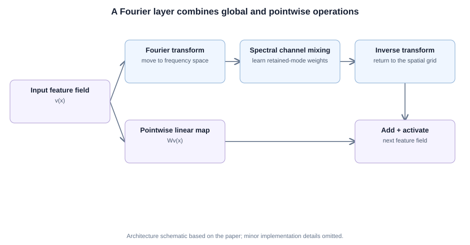

# [Paper Review] Fourier Neural Operator for Parametric Partial Differential Equations

> **Authors:** Zongyi Li, Nikola Kovachki, Kamyar Azizzadenesheli, Burigede Liu, Kaushik Bhattacharya, Andrew Stuart, Anima Anandkumar\
> **Institutions:** California Institute of Technology, Purdue University\
> **Publication:** ICLR 2021\
> **Link:** [https://arxiv.org/abs/2010.08895](https://arxiv.org/abs/2010.08895)

## Abstract & Introduction

Repeatedly solving a PDE for new coefficients or initial conditions is expensive. The Fourier Neural Operator learns the mapping from input functions to solution functions, using spectral layers to mix information across the domain efficiently. A trained model can then predict new solutions and transfer between compatible grid resolutions, making repeated forward evaluations much cheaper.

## Methods

<p align="center">
  
</p>

<p align="center"><em>The spectral branch mixes information globally; the pointwise branch acts locally. Schematic based on the paper.</em></p>

### Learning operators

An ordinary neural network maps finite-dimensional vectors to vectors. A neural operator instead represents a map between spaces of functions:

```math
G^\dagger:a\mapsto u,\qquad G_\theta(a)\approx G^\dagger(a).
```

For example, $a$ may be a spatially varying permeability field and $u$ the pressure field that solves a Darcy flow equation. Training examples contain sampled values of both functions on a grid. The desired mapping belongs to the underlying functions, even though its implementation uses discrete samples.

### Neural operator architecture

A local lifting network first maps the input into a wider feature representation, $v_0(x)=P(a(x))$. Repeated layers combine a pointwise linear transformation with an integral operator:

```math
v_{t+1}(x)=\sigma\left(
Wv_t(x)+\int_D\kappa_\theta(x,y,a(x),a(y))v_t(y)\,dy
\right).
```

The integral mixes information across the domain. A final pointwise projection $Q$ maps the features back to the output function. Thus the network lifts the input, repeatedly updates a field of features, and projects it to the solution.

### Fourier layers

FNO restricts the integral kernel to a convolution and learns its Fourier representation. The convolution theorem lets the network apply this global operation through multiplication in frequency space:

```math
v_{t+1}
=\sigma\left(Wv_t+
\mathcal F^{-1}\!\left(R_\theta\cdot\mathcal F(v_t)\right)\right).
```

<p align="center">
  
</p>

<p align="center"><em>Figure 1. Fourier layer architecture and an example of resolution transfer.</em></p>

First, an FFT transforms each feature channel. The layer retains a selected set of low-frequency modes and applies a learned complex-valued matrix to the channels at each retained frequency. An inverse FFT returns the result to the spatial domain, where it is combined with the pointwise branch and passed through a nonlinearity.

The spectral branch communicates globally across the grid. The pointwise branch preserves local information, and spatial nonlinearities can generate higher frequencies across successive layers. Truncating the learned spectral multipliers therefore does not require the final output to contain only the retained frequencies.

For a fixed number of retained modes and feature channels, the FFT gives approximately $O(n\log n)$ complexity in the number of grid points. The same spectral weights can be applied on compatible grids of different resolutions.

<p align="center">
  
</p>

<p align="center"><em>Figure 2. Lifting, repeated Fourier layers, and projection back to the solution field.</em></p>

## Results

### Navier–Stokes prediction

| Model | ν = 10⁻³, N = 1,000 | ν = 10⁻⁴, N = 1,000 | ν = 10⁻⁴, N = 10,000 | ν = 10⁻⁵, N = 1,000 |
| --- | ---: | ---: | ---: | ---: |
| FNO-3D | 0.0086 | 0.1918 | 0.0820 | 0.1893 |
| FNO-2D | 0.0128 | 0.1559 | 0.0834 | 0.1556 |
| U-Net | 0.0245 | 0.2051 | 0.1190 | 0.1982 |
| TF-Net | 0.0225 | 0.2253 | 0.1168 | 0.2268 |
| ResNet | 0.0701 | 0.2871 | 0.2311 | 0.2753 |

_Table 1, relative prediction error ↓ at 64×64 spatial resolution; N is the training-set size._ FNO-3D leads with sufficient data, while FNO-2D performs better in the harder, smaller-data settings.

### Resolution transfer and additional problems

| Experiment | Input → output | Reported result |
| --- | --- | --- |
| Burgers' equation | Initial velocity → later velocity | Low error remains stable across the tested resolutions |
| Darcy flow | Permeability → pressure | Strong accuracy across grid resolutions |
| Zero-shot super-resolution | Train at 64×64×20 → evaluate at 256×256×80 | Space-time resolution transfer without retraining |
| Bayesian inverse problem | Repeated forward solves inside MCMC | Surrogate posterior estimates closely match the numerical-solver estimates |

_Summary of Sections 5.1–5.5._ The same spectral parameterization supports both fast repeated prediction and evaluation on finer compatible grids.
