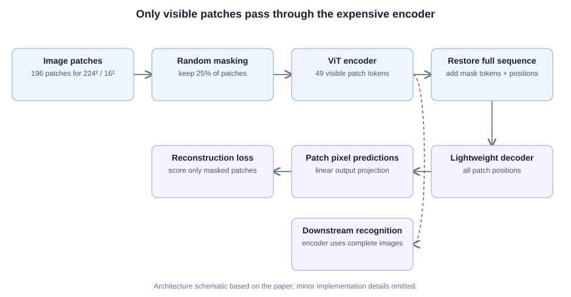

# [Paper Review] Masked Autoencoders Are Scalable Vision Learners

> **Authors:** Kaiming He, Xinlei Chen, Saining Xie, Yanghao Li, Piotr Dollár, Ross Girshick\
> **Institutions:** Facebook AI Research (FAIR)\
> **Publication:** CVPR 2022\
> **Link:** [https://arxiv.org/abs/2111.06377](https://arxiv.org/abs/2111.06377)

## Abstract & Introduction

Images are redundant enough that small missing regions can often be filled by interpolation. MAE removes most patches instead, asking a ViT to infer the missing content from sparse evidence. An asymmetric architecture sends only visible patches through the expensive encoder and reconstructs pixels with a small decoder, producing transferable representations while substantially reducing pretraining cost.

## Methods

<p align="center">
  
</p>

<p align="center"><em>MAE reconstructs masked pixels during pretraining and retains the encoder for recognition. Schematic based on the paper.</em></p>

### Random masking

The image is divided into non-overlapping patches as in ViT. A subset is sampled uniformly without replacement, and the remaining patches are removed. The default masking ratio is 75%.

For a $224\times224$ image with $16\times16$ patches, there are 196 image patches. A 75% mask leaves only 49 visible patches. Their spatial distribution provides scattered evidence about the scene while removing much of the local redundancy.

### Asymmetric encoder and decoder

<p align="center">
  
</p>

<p align="center"><em>Figure 1. Visible patches enter the encoder; mask tokens are introduced in the decoder.</em></p>

The encoder is a ViT applied only to the visible patches. Each patch receives a linear embedding and its positional embedding before entering the Transformer. The original positions are retained even though the encoder processes a shortened sequence.

After encoding, the visible representations are projected into the decoder's feature width. Learned mask tokens are inserted at the missing positions, and the full sequence is restored to its original spatial order. Positional embeddings distinguish the locations of otherwise identical mask tokens.

A small Transformer decoder predicts the pixels of each patch. The default decoder has eight blocks and width 512, making it much smaller than a ViT-Large encoder. The expensive encoder therefore processes only a quarter of the image tokens, while the lightweight decoder handles the complete sequence.

### Reconstruction objective

The final decoder layer projects each token into a vector of patch pixels. Training minimizes mean squared error on the masked patches:

```math
\mathcal L_{\mathrm{MAE}}
=\frac{1}{|M|}\sum_{i\in M}
\frac{1}{P^2C}\left\|\widehat x_i-x_i\right\|_2^2.
```

Here $M$ is the set of masked patches, $P$ is patch width, and $C$ is the number of image channels. The patch vector contains $P^2C$ pixel values.

The paper also normalizes each target patch using its own mean and standard deviation. This improves representation quality. Only masked patches contribute to the loss, so the model is not directly trained to reconstruct the visible patches.

### Implementation

Random shuffling makes masking straightforward. The model shuffles the patch sequence and keeps its first quarter for encoding. It appends mask tokens after encoding, then applies the inverse permutation to restore the complete spatial arrangement.

This uses ordinary dense Transformer operations on a shorter sequence. No specialized sparse attention implementation is required.

### Pretraining and evaluation

Pretraining uses ImageNet-1K images without labels. Evaluation includes full fine-tuning, linear probing with a frozen encoder, and partial fine-tuning of selected encoder blocks. Downstream recognition uses the complete unmasked image.

The paper studies ViT-Base, Large, and Huge. The ablations use ViT-Large to examine masking, decoder design, target normalization, augmentation, and pretraining duration.

## Results

### ImageNet fine-tuning

| Pretraining | ViT-B/16 | ViT-L/16 | ViT-H/14 | ViT-H/14 at 448² |
| --- | ---: | ---: | ---: | ---: |
| Supervised from scratch, authors' recipe | 82.3 | 82.6 | 83.1 | — |
| MoCo v3 | 83.2 | 84.1 | — | — |
| BEiT | 83.2 | 85.2 | — | — |
| MAE | 83.6 | 85.9 | 86.9 | 87.8 |

_Table 3, top-1 accuracy ↑; inputs are 224² unless stated._ MAE scales particularly well to larger encoders; BEiT additionally uses a tokenizer pretrained on external data.

### Decoder and target ablations

| ViT-L pretraining choice | Fine-tuning top-1 ↑ | Linear-probe top-1 ↑ | Relative training FLOPs ↓ |
| --- | ---: | ---: | ---: |
| Mask tokens in encoder | 84.2 | 59.6 | 3.3× |
| No mask tokens in encoder | 84.9 | 73.5 | 1× |
| Raw pixel target | 84.9 | 73.5 | — |
| Per-patch normalized target | 85.4 | 73.9 | — |

_Selected independent ablations from Table 1, using the 800-epoch setup._ Excluding encoder mask tokens improves efficiency and representation quality; normalizing target patches gives a further accuracy gain.

### COCO transfer

| Pretraining / backbone | Box AP ↑ | Mask AP ↑ |
| --- | ---: | ---: |
| Supervised / ViT-B | 47.9 | 42.9 |
| MAE / ViT-B | 50.3 | 44.9 |
| Supervised / ViT-L | 49.3 | 43.9 |
| MAE / ViT-L | 53.3 | 47.2 |

_Selected results from Table 4, ViT Mask R-CNN._ Masked pixel prediction improves localization and instance segmentation, with larger gains for ViT-L.

### Reconstruction

| Masked input → reconstruction → target | Finding |
| --- | --- |
|  | The decoder produces plausible completions despite seeing only 20% of patches |

_Figure 2 uses 80% masking._ Plausible hidden content can differ from the original image.
