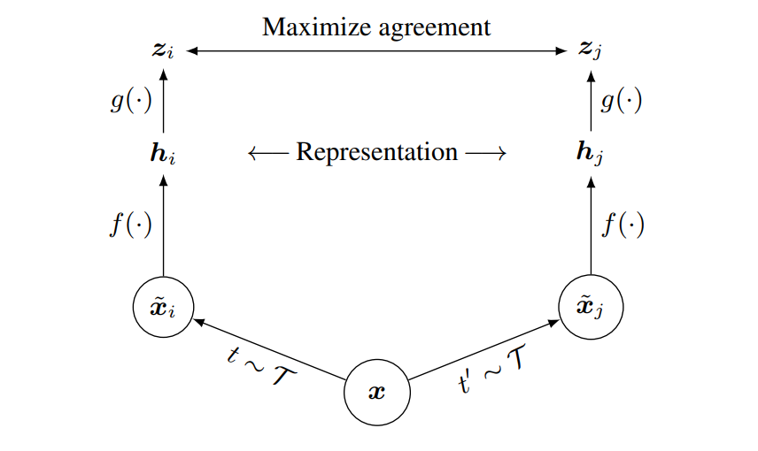

# [Paper Review] A Simple Framework for Contrastive Learning of Visual Representations

> **Authors:** Ting Chen, Simon Kornblith, Mohammad Norouzi, Geoffrey Hinton\
> **Institutions:** Google Research, Brain Team\
> **Publication:** ICML 2020\
> **Link:** [https://arxiv.org/abs/2002.05709](https://arxiv.org/abs/2002.05709)

## Abstract & Introduction

Useful visual features can be learned by recognizing two altered views of the same image. SimCLR combines random augmentation, a shared ResNet encoder, a nonlinear projection head, and a contrastive loss, without a memory bank. Its experiments show why augmentation, projection, and optimization matter, bringing self-supervised representations close to supervised performance on ImageNet.

## Methods

<p align="center">
  
</p>

<p align="center"><em>Figure 2. The SimCLR contrastive-learning framework. From the <a href="https://arxiv.org/abs/2002.05709">original paper</a>.</em></p>

### The contrastive learning framework

Two independently sampled transformations are applied to each image. These produce a positive pair: two views of the same original image. Each view passes through the same ResNet encoder $f$, followed by a small projection network $g$:

```math
h_i=f(\widetilde x_i),\qquad z_i=g(h_i).
```

The encoder representation $h_i$ is the output after global average pooling. The projection head is a two-layer MLP with a ReLU activation. The contrastive objective acts on $z_i$; downstream tasks use $h_i$ after discarding the head.


For a minibatch of $N$ images, augmentation creates $2N$ views. Each view has one positive counterpart and $2N-2$ negatives from the other images. The normalized temperature-scaled cross entropy loss, or NT-Xent, is

```math
\ell_{i,j}=-\log
\frac{\exp(\mathrm{sim}(z_i,z_j)/\tau)}
{\sum_{k=1}^{2N}\mathbf 1_{[k\ne i]}
\exp(\mathrm{sim}(z_i,z_k)/\tau)}.
```

Here $\mathrm{sim}$ is cosine similarity and $\tau$ is the temperature. The denominator includes the positive view and excludes the anchor itself. Both directions of every positive pair contribute to the batch loss:

```math
\mathcal L=\frac{1}{2N}\sum_{k=1}^{N}
\left[\ell_{2k-1,2k}+\ell_{2k,2k-1}\right].
```

### Data augmentation

The augmentation pipeline combines random cropping and resizing, color distortion, and Gaussian blur. Cropping creates views that can contain different parts of an object or different amounts of context. Color distortion makes it harder to identify a positive pair by its color distribution alone.

The combination matters more than any single transformation. Without strong color changes, the network can exploit similarities between the color histograms of crops. This solves the training task without requiring the representations needed for recognition. Stronger augmentation works particularly well for contrastive learning, even when the same transformations would be less useful in supervised training.

### Encoder and projection head

The paper studies deeper and wider ResNets. Increasing model capacity improves the learned representations. A nonlinear projection head also improves the representation before the head, even though the head is discarded afterward.

One explanation is that the contrastive loss encourages invariance to the chosen transformations. Applying all of that pressure directly to the downstream representation can remove useful information. The head provides a separate space in which to enforce agreement.

### Training and evaluation

Training uses large batches, with up to 8,192 original images, and the LARS optimizer. Global batch normalization shares statistics across devices, preventing a network from exploiting local batch statistics to identify matching views. Larger batches provide more negatives per update. Longer training also helps and reduces some of the gap between smaller and larger batches.

The main evaluation freezes the encoder and trains a linear classifier on its representations. Additional experiments fine-tune the model with limited labels and evaluate transfer to other datasets.

## Results

### ImageNet linear evaluation

| Method / backbone | Parameters | Top-1 ↑ | Top-5 ↑ |
| --- | ---: | ---: | ---: |
| MoCo / ResNet-50 | 24M | 60.6 | — |
| PIRL / ResNet-50 | 24M | 63.6 | — |
| CPC v2 / ResNet-50 | 24M | 63.8 | 85.3 |
| SimCLR / ResNet-50 | 24M | 69.3 | 89.0 |
| SimCLR / ResNet-50 2× | 94M | 74.2 | 92.0 |
| SimCLR / ResNet-50 4× | 375M | 76.5 | 93.2 |

_Selected results from Table 6._ The standard-width model already improves over the compared ResNet-50 methods; the 76.5% headline uses a much wider model.

### Fine-tuning with limited labels

| Backbone | 1% labels, top-5 ↑ | 10% labels, top-5 ↑ |
| --- | ---: | ---: |
| Supervised ResNet-50 baseline | 48.4 | 80.4 |
| SimCLR / ResNet-50 | 75.5 | 87.8 |
| SimCLR / ResNet-50 2× | 83.0 | 91.2 |
| SimCLR / ResNet-50 4× | 85.8 | 92.6 |

_Selected results from Table 7._ Unlabeled pretraining makes the limited labeled set much more useful.

### Component studies

| Component | Reported finding |
| --- | --- |
| Cropping + color distortion | More effective together; color distortion reduces shortcuts between crops |
| Nonlinear projection head | Improves the representation before the discarded head |
| Feature normalization + temperature | Both are important to the contrastive objective |
| Larger batches | Supply more negatives and improve performance |
| Longer training | Improves performance and reduces the disadvantage of smaller batches |
| Transfer to 12 datasets | Fine-tuned SimCLR wins on 5, ties on 5, and loses on 2 against the supervised baseline |

_Summary of Sections 3–6._ Most of the gains come from designing the training task and optimization carefully.
