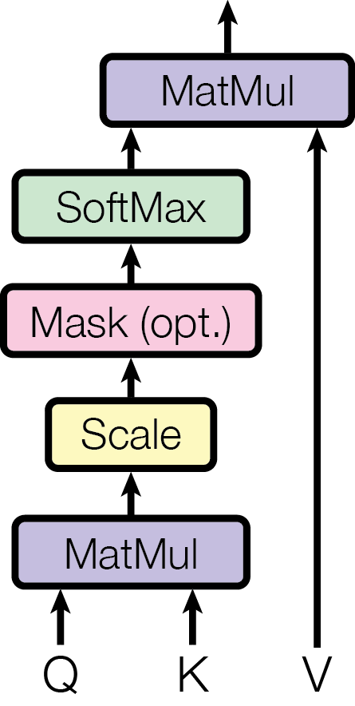
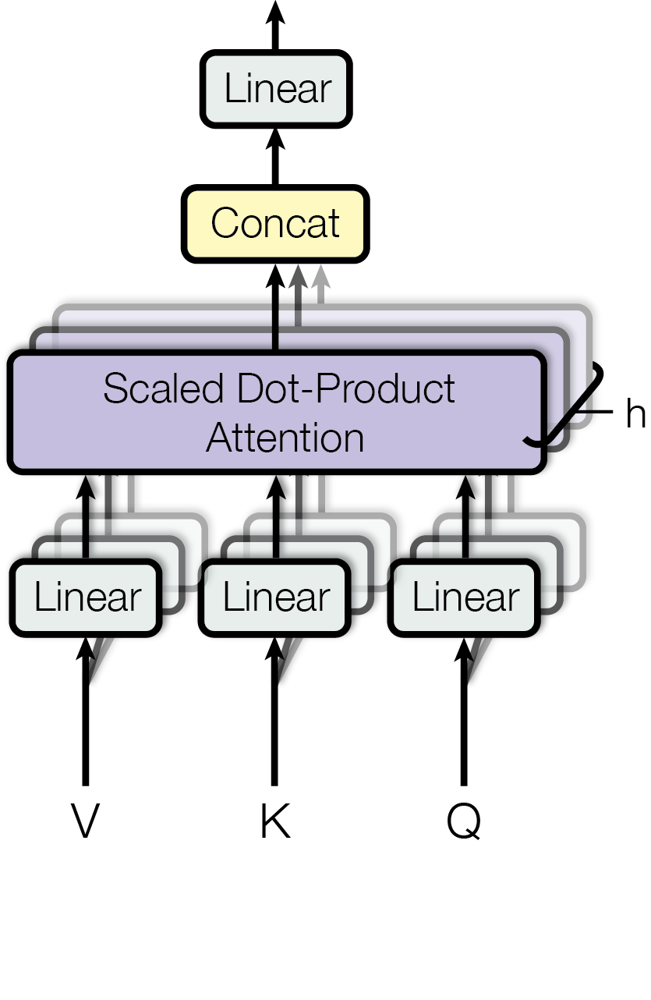
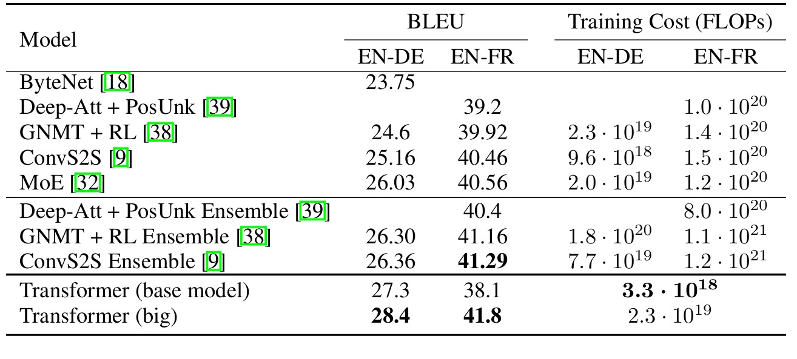
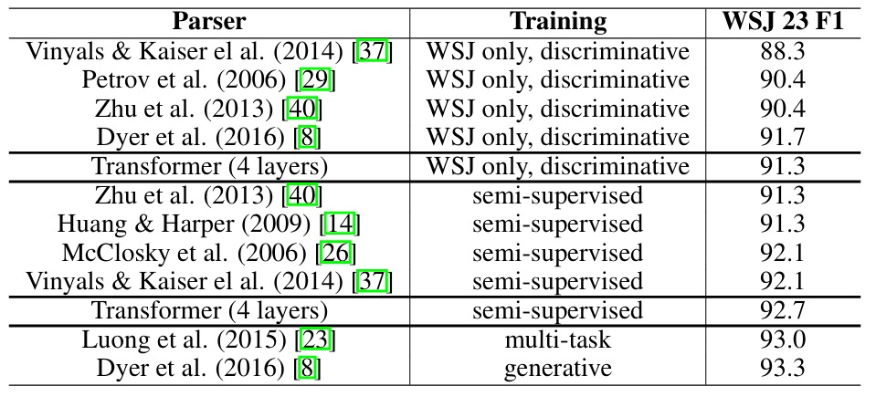

# [Paper Review] Attention Is All You Need

> **Authors:** Ashish Vaswani, Noam Shazeer, Niki Parmar, Jakob Uszkoreit, Llion Jones, Aidan N. Gomez, Łukasz Kaiser, Illia Polosukhin\
> **Institutions:** Google Brain, Google Research, University of Toronto\
> **Publication:** NeurIPS 2017\
> **Link:** https://arxiv.org/abs/1706.03762

## Abstract & Introduction

Recurrent translation models process tokens sequentially, limiting parallel training and making distant interactions costly. The Transformer replaces recurrence with self-attention, combining multi-head attention, position-wise feed-forward networks, and positional encodings in an encoder–decoder architecture. It improves WMT translation quality with substantially less training computation and also transfers to constituency parsing.

## Methods

<p align="center">
  
</p>

<p align="center"><em>Figure 1. The Transformer encoder–decoder architecture. From the <a href="https://arxiv.org/abs/1706.03762">original paper</a>.</em></p>

### Model architecture

The Transformer uses an encoder-decoder architecture: the encoder maps the source sequence to contextual representations, and the decoder generates the output one token at a time, conditioned on these representations and the previously generated tokens.

The base model has six encoder and six decoder layers, with $`d_{\mathrm{model}}=512`$. Each encoder layer contains multi-head self-attention and a position-wise feed-forward network. Each decoder layer contains masked self-attention, encoder-decoder attention, and a feed-forward network. Every sublayer uses a residual connection followed by layer normalization. The decoder inputs are shifted right by one token; together with causal masking, this prevents predictions from accessing the target token being predicted or later tokens. Training processes target positions in parallel, while generation proceeds sequentially.

### Scaled dot-product attention

<p align="center">
  
</p>

<p align="center"><em> Figure 2.1. Scaled dot-product attention.</em></p>


Queries and keys have dimension $`d_k`$; values have dimension $`d_v`$. With queries, keys, and values packed into matrices:

```math
\mathrm{Attention}(Q,K,V)=\mathrm{softmax}\left(\frac{QK^\top}{\sqrt{d_k}}\right)V.
```

Softmax operates across each row of the score matrix. In self-attention, the matrix has shape $`n\times n`$, connecting every query position to every key position.

Assuming independent query and key components with zero mean and unit variance, their dot product has variance $`d_k`$. Dividing by $`\sqrt{d_k}`$ prevents large scores from pushing softmax into regions with small gradients. Dot-product attention also benefits from efficient matrix multiplication.

### Multi-head attention

<p align="center">
  
</p>

<p align="center"><em> Figure 2.2. Multi-head attention.</em></p>

Each head applies separate learned projections before computing attention. The outputs are concatenated and projected:

```math
\mathrm{head}_i=\mathrm{Attention}(QW_i^Q,KW_i^K,VW_i^V).
```

```math
\mathrm{MultiHead}(Q,K,V)=\mathrm{Concat}(\mathrm{head}_1,\ldots,\mathrm{head}_h)W^O.
```

Different heads can attend to different positions and representation subspaces. The base model uses eight heads with $`d_k=d_v=64`$. Their outputs concatenate to 512 dimensions. Smaller dimensions per head keep the total computational cost similar to one head at full dimensionality.

### Position-wise feed-forward networks

Each layer applies two linear transformations with a ReLU activation function in between. The network expands from 512 to 2048 dimensions and returns to 512. Attention mixes information across tokens; the feed-forward network transforms each token independently.

### Positional encoding

Because self-attention alone does not encode order, positional vectors are added to embeddings at the bottoms of both stacks:

```math
PE_{(p,2j)}=\sin\left(\frac{p}{10000^{2j/d_{\mathrm{model}}}}\right).
```

```math
PE_{(p,2j+1)}=\cos\left(\frac{p}{10000^{2j/d_{\mathrm{model}}}}\right).
```

Here $`p`$ denotes position and $`j`$ indexes sine-cosine pairs. Different frequencies encode position at different scales. For fixed offset $`k`$, the encoding at $`p+k`$ is a linear transformation of the encoding at $`p`$, motivating their use for relative positions. Learned positional embeddings performed similarly; sinusoids were chosen for possible extrapolation to longer sequences.

### Training 

The model was trained on the WMT 2014 English-German dataset and the WMT 2014 English-French dataset, containing 4.5 million and 36 million sentences each. Training uses Adam, residual dropout, and label smoothing. The model was trained on eight NVIDIA P100 GPUs.

## Results

### Machine translation

<p align="center">
  
</p>

_Table 2._ Transformer-Big improves both translation benchmarks; the base model already exceeds the listed baselines on English–German.

### Architecture ablations

| Change from the base model | EN–DE development BLEU ↑ |
| --- | ---: |
| Base: 8 attention heads | 25.8 |
| 1 attention head | 24.9 |
| 32 attention heads | 25.4 |
| No dropout | 24.6 |
| Learned position embeddings | 25.7 |

_Selected results from Table 3, newstest2013._ Multiple heads and dropout help, while learned and sinusoidal positions perform similarly.

### English constituency parsing

<p align="center">
  
</p>

_Table 4._ The Transformer transfers well to parsing, although the strongest compared parsers still score higher.
