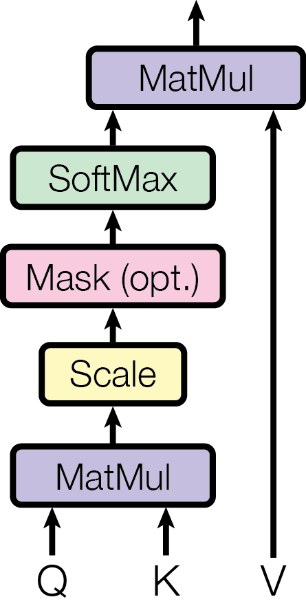
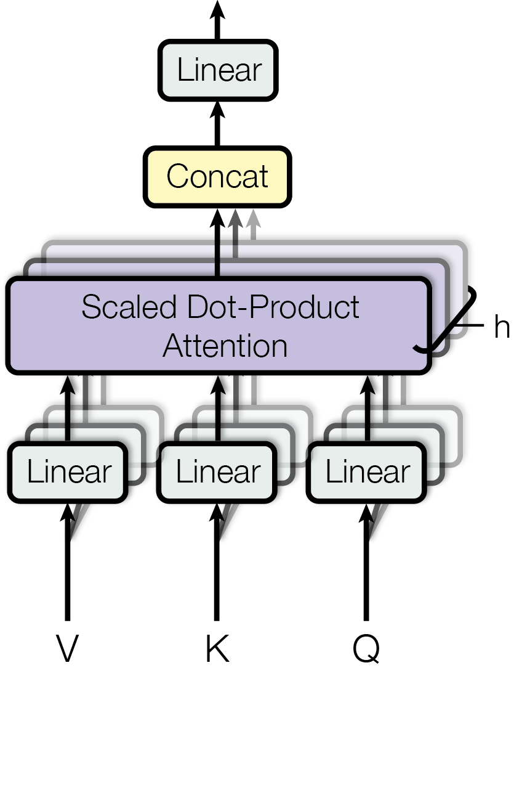
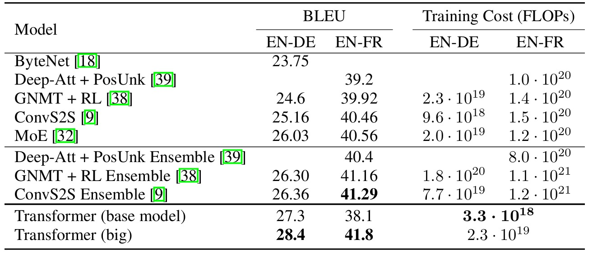
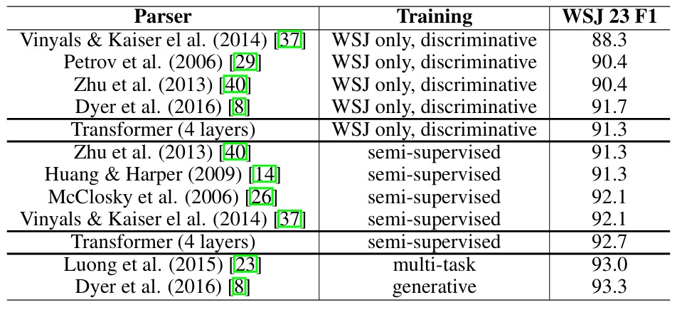

# [Paper Review] Attention Is All You Need

> **Authors:** Ashish Vaswani, Noam Shazeer, Niki Parmar, Jakob Uszkoreit, Llion Jones, Aidan N. Gomez, Łukasz Kaiser, Illia Polosukhin\
> **Institutions:** Google Brain, Google Research, University of Toronto\
> **Publication:** NeurIPS 2017\
> **Link:** https://arxiv.org/abs/1706.03762

## Abstract & Introduction

Recurrent neural networks (RNNs) have long been the architecture of choice for natural language processing tasks such as machine translation. However, the sequential RNNs have two large shortcomings: parallelization is difficult, and relationships between far apart tokens are difficult to model. There have been attempts to use convolutional neural networks (CNNs) alongside RNNs in order to reduce sequential computation. 

This paper proposes the Transformer, a model that relies entirely on the attention mechanism to model global dependencies between input and output sequences. Without reliance on any recurrence or convolution, the model achieves significantly more parallelization and reaches state of the art results on machine translation benchmarks. 

## Methods

### Model architecture

The Transformer follows an encoder-decoder structure. The encoder maps the source tokens to contextual representations, and the decoder uses these representations to generate the target sequence one token at a time. Each prediction depends on the source sequence and the previously generated target tokens.

  

<em>Figure 1. The Transformer model architecture. Source: Vaswani et al., Figure 1.</em>

### 3.1 Encoder and decoder stacks

The base model has six encoder layers and six decoder layers, with $d_{\mathrm{model}}=512$. Each encoder layer contains two sublayers: multi-head self-attention and a position-wise feed-forward network. The encoder is bidirectional: each source position can attend to every source position.

Each decoder layer has three sublayers, in order: masked multi-head self-attention, encoder-decoder attention, and a position-wise feed-forward network. Encoder-decoder attention lets the decoder use the final encoder representations when predicting the target sequence.

Every sublayer has a residual connection followed by layer normalization:

$$
\operatorname{LayerNorm}\bigl(x+\operatorname{Sublayer}(x)\bigr).
$$

This is the original *post-norm* arrangement. All sublayers and embedding layers produce vectors of dimension $d_{\mathrm{model}}$, allowing the residual additions. The residual path carries the previous representation forward while the sublayer learns an update. Layer normalization operates on each token's feature vector rather than mixing token positions.

The decoder's target inputs are shifted right by one position. Together with causal masking, this ensures that the prediction for target token $y_i$ can depend only on earlier target tokens $y_1,\ldots,y_{i-1}$. During training, the shifted target sequence is available, so all positions can be processed in parallel; during generation, target tokens are produced sequentially.

### 3.2 Attention

An attention function takes a query and a set of key-value pairs. It compares the query with each key to obtain weights, then returns a weighted sum of the corresponding values. Queries and keys determine which information is relevant; values contain the information to combine.

#### 3.2.1 Scaled dot-product attention

  

<em>Figure 2 (left). Scaled dot-product attention. Source: Vaswani et al., Figure 2.</em>

Queries and keys have dimension $d_k$, while values have dimension $d_v$. Packing them into matrices allows attention to be computed for several queries simultaneously:

$$
\operatorname{Attention}(Q,K,V)
=
\operatorname{softmax}\left(\frac{QK^\top}{\sqrt{d_k}}\right)V.
$$

For self-attention in one head, a sequence representation $X\in\mathbb{R}^{n\times d_{\mathrm{model}}}$ is projected into $Q=XW^Q$, $K=XW^K$, and $V=XW^V$. The score matrix $QK^\top$ has shape $n\times n$: row $i$ contains the scores from token $i$ to every token. Softmax operates across each row, and multiplication by $V$ produces a weighted combination of value vectors for each query.

The scale factor can be motivated by assuming independent query and key components with mean zero and variance one. Their dot product sums $d_k$ terms and has variance $d_k$; dividing by $\sqrt{d_k}$ brings its variance to one under these assumptions. Without scaling, large dot products can make softmax extremely concentrated, leaving small gradients.

The paper compares this with additive attention, which scores compatibility using a feed-forward network. Dot-product attention is efficient in practice because it uses optimized matrix multiplication; scaling addresses its behavior at larger key dimensions.

#### 3.2.2 Multi-head attention

  

<em>Figure 2 (right). Multi-head attention. Source: Vaswani et al., Figure 2.</em>

Multi-head attention applies different learned projections to the queries, keys, and values, then runs attention independently for each head. The outputs are concatenated and projected again:

$$
\mathrm{head}_r
=
\operatorname{Attention}(QW_r^Q,KW_r^K,VW_r^V).
$$

$$
\operatorname{MultiHead}(Q,K,V)
=
\operatorname{Concat}(\mathrm{head}_1,\ldots,\mathrm{head}_h)W^O.
$$

Here $Q,K,V$ denote the inputs before the head-specific projections. The learned projection matrices have dimensions

$$
W_r^Q,W_r^K\in\mathbb{R}^{d_{\mathrm{model}}\times d_k},
\qquad
W_r^V\in\mathbb{R}^{d_{\mathrm{model}}\times d_v},
\qquad
W^O\in\mathbb{R}^{h d_v\times d_{\mathrm{model}}}.
$$

In the base model, $h=8$ and $d_k=d_v=d_{\mathrm{model}}/h=64$. Concatenating the eight outputs restores 512 dimensions, and $W^O$ combines the heads. Reducing the dimension of each head keeps the computational cost similar to a single attention head operating at full dimensionality.

Different projections let the model attend to different positions and representation subspaces simultaneously. A single weighted average can obscure these different relationships; multiple heads provide several combinations of information. Individual heads are not explicitly assigned grammatical roles.

#### 3.2.3 Applications of attention in the model

The Transformer uses multi-head attention in three ways:

- **Encoder-decoder attention:** Queries come from the decoder sublayer below it, while keys and values come from the final encoder output. Each target position can attend to every source position. The score matrix can be rectangular when source and target lengths differ.
- **Encoder self-attention:** Queries, keys, and values come from the same encoder representation. Each source position can attend to all source positions.
- **Decoder self-attention:** Queries, keys, and values come from the same decoder representation, but each position can attend only to itself and earlier positions in the shifted target sequence.

Causal masking sets scores for forbidden future positions to $-\infty$ before softmax, giving those positions zero attention weight. Because the target input is shifted, attending to the current decoder input position does not reveal the target token being predicted.

A decoder position therefore combines what has already been written, through masked self-attention, with what the source says, through encoder-decoder attention.

### 3.3 Position-wise feed-forward networks

Each encoder and decoder layer also contains a feed-forward network consisting of two linear transformations with a ReLU activation between them:

$$
\operatorname{FFN}(x)
=
\max(0,xW_1+b_1)W_2+b_2.
$$

The same transformation is applied independently to every position within a layer, but different layers have different parameters. In the base model, the network expands from $d_{\mathrm{model}}=512$ to $d_{\mathrm{ff}}=2048$ dimensions, then returns to 512 dimensions. It mixes features within each token representation, while attention exchanges information between tokens. The paper also describes this as two convolutions with kernel size one.

### 3.4 Embeddings and softmax

Learned embeddings convert source and target tokens into $d_{\mathrm{model}}$-dimensional vectors. At the decoder output, a learned linear transformation followed by softmax produces probabilities for the next target token.

The paper shares the weight matrix between the source embeddings, target embeddings, and output linear transformation, using the transpose as needed for the output projection. In the embedding layers, the embedding vectors are multiplied by $\sqrt{d_{\mathrm{model}}}$.

### 3.5 Positional encoding

Self-attention alone does not encode token order. Permuting its input tokens permutes its outputs, so the model needs position information to distinguish sequences containing the same tokens in different orders. The paper adds positional encodings to token embeddings at the bottoms of both the encoder and decoder stacks. Both vectors have dimension $d_{\mathrm{model}}$, allowing them to be added.

The fixed encodings use sine and cosine functions at different frequencies:

$$
PE_{(p,2j)}
=
\sin\left(\frac{p}{10000^{2j/d_{\mathrm{model}}}}\right).
$$

$$
PE_{(p,2j+1)}
=
\cos\left(\frac{p}{10000^{2j/d_{\mathrm{model}}}}\right).
$$

Here $p$ is the token position, and $j$ indexes the sine-cosine pairs of feature dimensions. Different frequencies represent position at different scales. For any fixed offset $k$, the encoding at $p+k$ can be expressed as a linear transformation of the encoding at $p$, which motivated the authors' hypothesis that these encodings would help the model learn relative positions.

Learned positional embeddings produced nearly identical results. The authors chose the sinusoidal version because it might generalize to sequence lengths longer than those encountered during training.

### Training 

The model was trained on the WMT 2014 English-German dataset and the WMT 2014 English-French dataset, containing 4.5 million and 36 million sentences each. The Adam optimizer, residual dropout and label smoothing was used. The model was trained on eight NVIDIA P100 GPUs. 

## Results

### Translation quality and efficiency

The Transformer achieves state-of-the-art BLEU scores on both English-to-German and English-to-French translation tasks as the fraction of the training cost. 

  

<em>Table 2. BLEU scores and training costs of English-to-German and English-to-French translation models.</em>

### English Constituency Parsing

In order to evaluate the Transformer for other NLP tasks, its performance on English constituency parsing was experimented. The Wall Street Journal (WSJ) portion of the Penn Treebank and BerkeleyParser datasets were used. Despite the lack of task-specific tuning, the Transformer outperformed all previous models except one. 

  

<em>Table 4. English constituency parsing results. </em>

