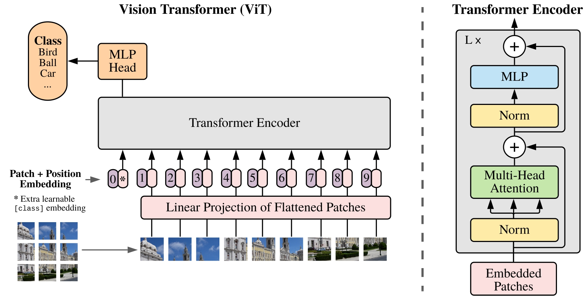
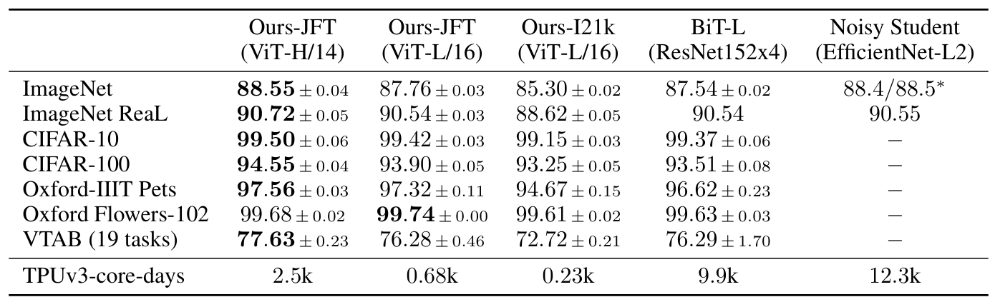
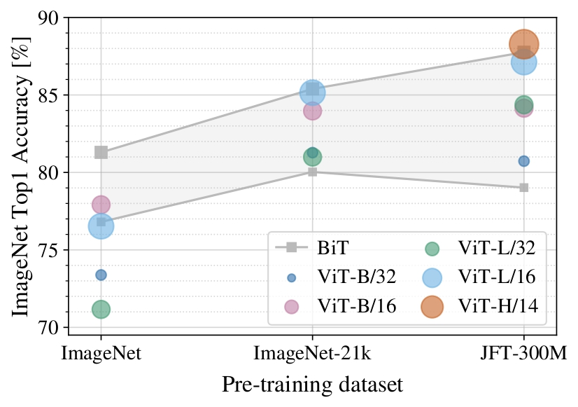
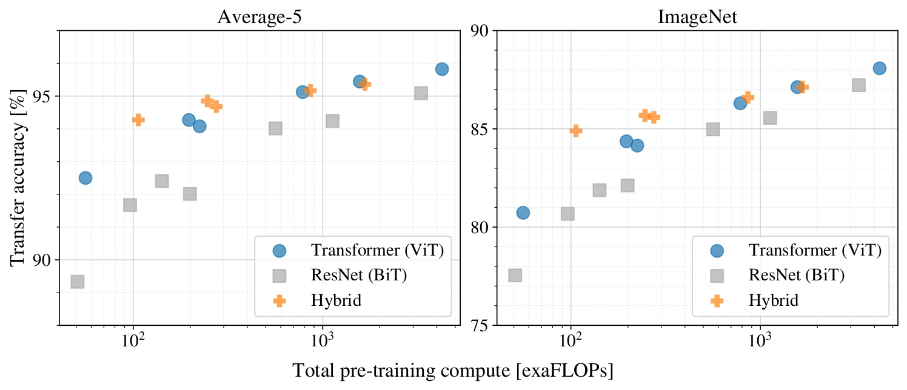
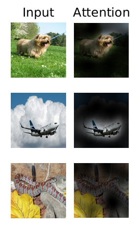

# [Paper Review] An Image is Worth 16x16 Words: Transformers for Image Recognition at Scale

> **Authors:** Alexey Dosovitskiy, Lucas Beyer, Alexander Kolesnikov, Dirk Weissenborn, Xiaohua Zhai, Thomas Unterthiner, Mostafa Dehghani, Matthias Minderer, Georg Heigold, Sylvain Gelly, Jakob Uszkoreit, Neil Houlsby\
> **Institutions:** Google Research, Brain Team\
> **Publication:** ICLR 2021\
> **Link:** https://arxiv.org/abs/2010.11929

## Abstract & Introduction

In natural language processing (NLP), Transformers had become a dominant architecture by the time of this paper. Through pretraining on a large text corpus then fine-tuning, Transformers have shown strong performance on many NLP tasks. However, convolutional neural networks (CNNs) remained the dominant architecture at the time in computer vision. There have been multiple attempts to introduce the self-attention mechanism to various parts of CNNs, often while retaining a convolutional backbone. 

This paper takes a different approach; instead of relying on CNNs, Transformers are applied directly to supervised image classification with as few modifications from the original architecture as possible. Images are split into patches, each of which is treated the same way as tokens in NLP tasks. 

On smaller pretraining datasets, Vision Transformers (ViTs) lag behind in accuracy compared to CNNs of comparable sizes. This is due to ViTs having fewer built-in inductive biases like translation equivariance and locality, both of which are inherent to CNNs. However, ViTs perform at the state of the art level on large datasets.

## Method

### Model 

<p align="center">
  
</p>

<p align="center"><em>Figure 1. Patch embeddings and a class token enter a Transformer encoder.</em></p>

**Patch and position embeddings.** An image of size $`H\times W`$ with $`C`$ channels is split into $`N=HW/P^2`$ non-overlapping patches. Each flattened patch contains $`P^2C`$ values and is projected into a $`D`$-dimensional embedding. A learnable class token is prepended, and learned 1D position embeddings are added:

```math
z_0=[x_{\mathrm{class}};x_p^1E;\ldots;x_p^NE]+E_{\mathrm{pos}}.
```

```math
E\in\mathbb{R}^{(P^2C)\times D},
\qquad E_{\mathrm{pos}}\in\mathbb{R}^{(N+1)\times D}.
```

For example, a $`224\times224`$ RGB image with $`16\times16`$ patches yields 196 patches of 768 values each, or 197 tokens including the class token. Patch size and embedding dimension are separate choices. Smaller patches produce longer sequences and increase attention cost.

**Transformer encoder and classification.** Each of the $`L`$ encoder layers contains multi-head self-attention (MSA) and a two-layer MLP with GELU. Layer normalization precedes each sublayer, and residual connections follow:

```math
z'_\ell=\mathrm{MSA}(\mathrm{LN}(z_{\ell-1}))+z_{\ell-1}.
```

```math
z_\ell=\mathrm{MLP}(\mathrm{LN}(z'_\ell))+z'_\ell.
```

The final class-token state becomes the image representation after normalization:

```math
y=\mathrm{LN}(z_L^0).
```

The input class token is shared across images, but its output becomes image-specific through attention. A classification head uses this representation: an MLP with one hidden layer during pretraining and a linear layer during fine-tuning. ViT uses an encoder for classification, so no causal mask or autoregressive decoder is needed.

### Experiments

Pretraining uses ImageNet, ImageNet-21k, or JFT-300M. Evaluation includes ImageNet, CIFAR-10/100, Pets, Flowers, and VTAB. The paper compares ViT-Base, Large, and Huge with ResNet (BiT) and hybrid models. In names such as ViT-L/16, the letter indicates model size and the number indicates patch width.

Pretraining uses Adam; fine-tuning uses SGD with momentum. 

## Results

<p align="center">
  
</p>

<p align="center"><em>Table 2. Image classification benchmark results.</em></p>

The ViT models trained on the larger JFT-300M dataset outperform state-of-the-art CNN models on all datasets despite requiring substantially less compute for pretraining. ViT models trained on the smaller ImageNet-21k also performs well. 

<p align="center">
  
</p>

<p align="center"><em>Figure 3. ImageNet transfer accuracy versus pretraining dataset size.</em></p>

ViT trails CNNs with smaller pretraining datasets but improves strongly with scale. Larger ViT models also require more data to realize their advantage.

<p align="center">
  
</p>

<p align="center"><em>Figure 5. Transfer performance versus pretraining compute.</em></p>

Using the same JFT-300M dataset, ViTs, ResNets and hybrids were assessed on performance versus pretraining cost. ViTs have significantly better performance/compute ratios compared to ResNets; ViT uses approximately 2 to 4 times less compute to attain the same performance. Hybrids slightly outperform ViTs at small computational budgets but this pattern disappears for larger budgets. 

<p align="center">
  
</p>

<p align="center"><em>Figure 6. Output-token attention over image regions.</em></p>

Attention highlights regions relevant to classification, although attention weights alone do not establish causal explanations.

