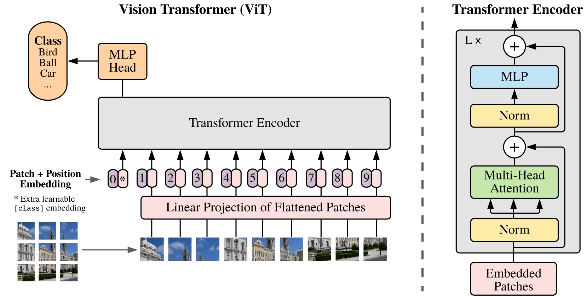
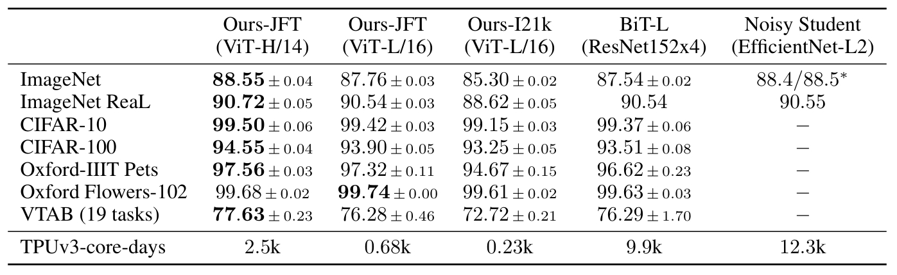
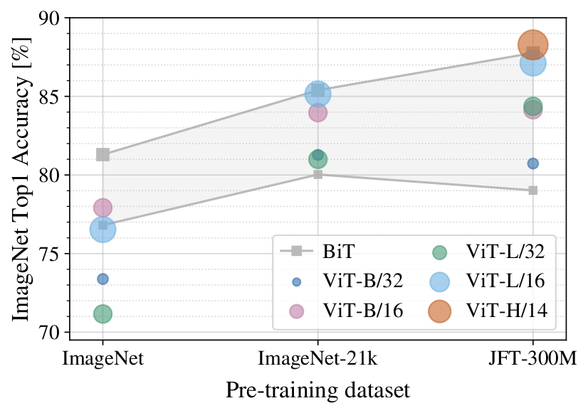
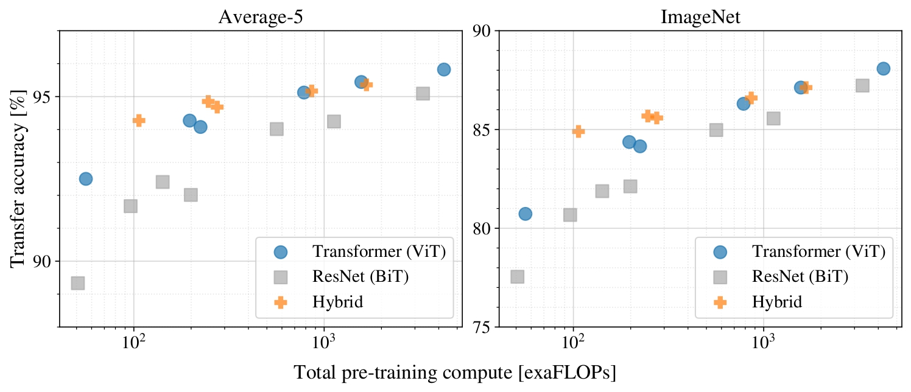
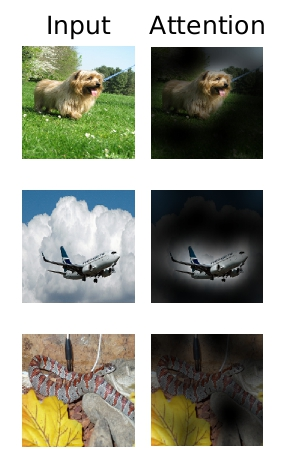

# [Paper Review] An Image is Worth 16x16 Words: Transformers for Image Recognition at Scale

> **Authors:** Alexey Dosovitskiy, Lucas Beyer, Alexander Kolesnikov, Dirk Weissenborn, Xiaohua Zhai, Thomas Unterthiner, Mostafa Dehghani, Matthias Minderer, Georg Heigold, Sylvain Gelly, Jakob Uszkoreit, Neil Houlsby\
> **Institutions:** Google Research, Brain Team\
> **Publication:** ICLR 2021\
> **Link:** https://arxiv.org/abs/2010.11929

## Abstract & Introduction

In natural language processing (NLP), Transformers had become a dominant architecture by the time of this paper. Through pretraining on a large text corpus then fine-tuning, Transformers have shown strong performance on many NLP tasks. However, convolutional neural networks (CNNs) remained the dominant architecture at the time in computer vision. There have been multiple attempts to introduce the self-attention mechanism to various parts of CNNs, often while retaining a convolutional backbone. 

This paper takes a different approach; instead of relying on CNNs, Transformers are applied directly to supervised image classification with as few modifications from the original architecture as possible. Images are split into patches, each of which is treated the same way as tokens in NLP tasks. 

On smaller pretraining datasets, Vision Transformers (ViTs) lag behind in accuracy compared to CNNs of comparable sizes. This is due to ViTs having fewer built-in inductive biases like translation equivariance and locality, both of which are inherent to CNNs. However, ViTs perform at the state of the art level on large datasets.

## Methods

### Turning an image into tokens

An image of size $H\times W$ is split into $N=HW/P^2$ non-overlapping patches. Flattened patches are projected into embeddings; a learnable class token and position embeddings form the input:

$$
z_0=[x_{\mathrm{class}};x_p^1E;\ldots;x_p^NE]+E_{\mathrm{pos}}.
$$

For example, a $224\times224$ RGB image with $16\times16$ patches yields 196 patches, each containing 768 pixel values. The learned projection converts each flattened patch into a $D$-dimensional token; adding the class token gives a sequence of length 197. Patch size and embedding dimension are separate choices.

Larger patches shorten the sequence and reduce attention cost, but represent the image more coarsely. Smaller patches retain finer spatial detail at a higher computational cost. Position embeddings tell the model which patch came from which location.

### Encoder and classification

Pre-normalized attention and MLP blocks use residual connections. The final class-token representation feeds a classification head. 

  

<em>Figure 1. Patch embeddings enter a Transformer encoder.</em>

The learnable class token is shared across images at the input; its output becomes image-specific through repeated attention to patch representations. It serves as a place to gather information for classification, rather than representing one particular image patch.

Each encoder block follows

$
z'_\ell=z_{\ell-1}+\operatorname{MSA}(\operatorname{LN}(z_{\ell-1})),
$

$
z_\ell=z'_\ell+\operatorname{MLP}(\operatorname{LN}(z'_\ell)).
$

Unlike the original Transformer's post-norm arrangement, normalization precedes each sublayer. The MLP uses GELU. ViT uses an encoder for classification, so it needs neither causal masking nor an autoregressive decoder.

### Pretraining and fine-tuning

Models are pretrained on ImageNet, ImageNet-21k, or JFT-300M, then fine-tuned; position embeddings are interpolated for higher resolution.

Pretraining learns representations from a large labeled dataset. Fine-tuning adapts them to a downstream task with its own classification head. Increasing resolution creates more patch tokens; interpolating the spatial position embeddings adapts the learned positional grid to this new sequence length.

## Results

### Transfer accuracy

JFT-pretrained **ViT-H/14 reaches 88.55% ImageNet and 94.55% CIFAR-100 accuracy** after fine-tuning (Table 2).

  

<em>Table 2. Transfer accuracy and pretraining cost.</em>

These are transfer-learning results, not accuracies obtained by training from scratch on each benchmark. The strength of the pretrained representation and the amount of pretraining data are essential to interpreting the comparison.

### Data and compute

ViT trails CNNs with smaller pretraining datasets but improves strongly with scale. In the controlled scaling study, it needs approximately **2–4 times less pretraining compute** for comparable average transfer performance.

  

<em>Figure 3. Larger pretraining datasets benefit ViT.</em>

  

<em>Figure 5. Performance versus pretraining compute.</em>

### Attention visualization

Class-token attention highlights relevant image regions. Attention weights alone do not establish causal explanations.

  

<em>Figure 6. Output-token attention over image regions.</em>

CNNs build locality and weight sharing into their architecture, whereas ViT learns many spatial relationships from data. Weaker inductive bias gives the model more flexibility, but fewer constraints can make learning harder when data are scarce. This explains why model size alone is insufficient: its benefit depends on the data available for pretraining.

The gains depend on substantial pretraining data.
