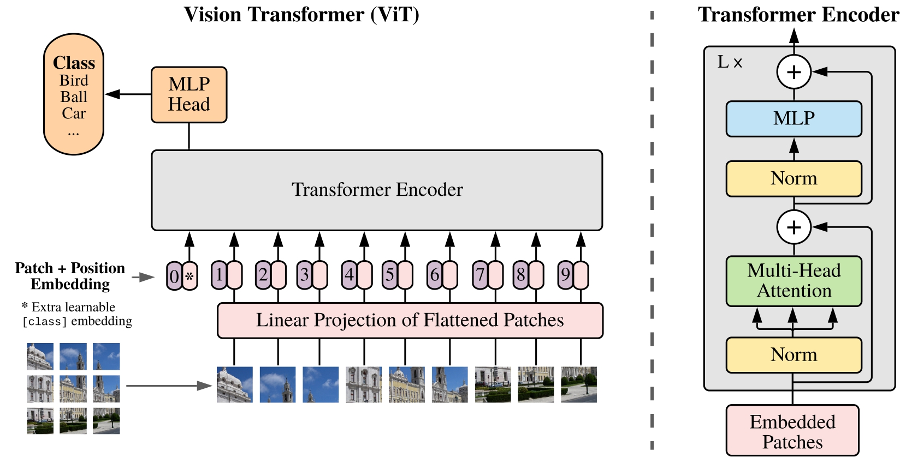
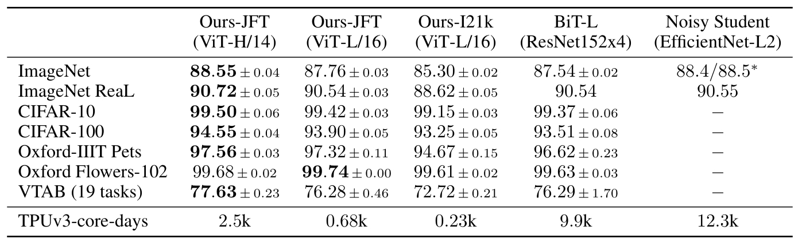
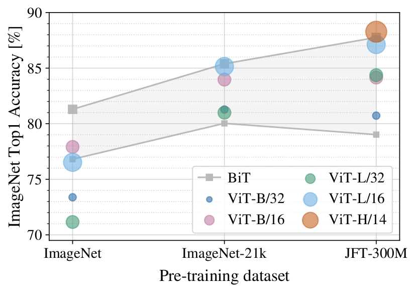
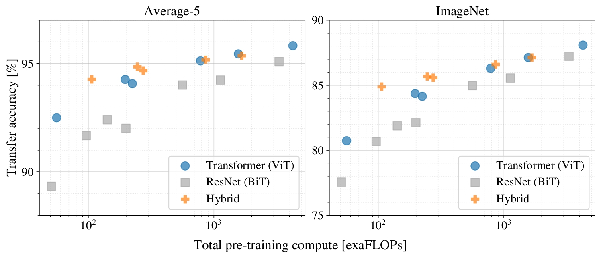
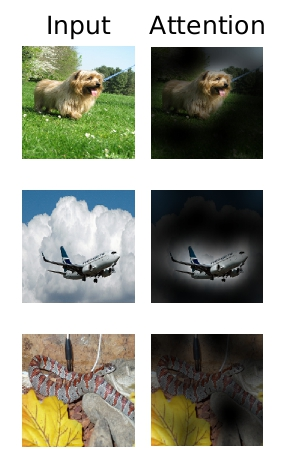

# [Paper Review] An Image is Worth 16x16 Words: Transformers for Image Recognition at Scale

> **Authors:** Alexey Dosovitskiy, Lucas Beyer, Alexander Kolesnikov, Dirk Weissenborn, Xiaohua Zhai, Thomas Unterthiner, Mostafa Dehghani, Matthias Minderer, Georg Heigold, Sylvain Gelly, Jakob Uszkoreit, Neil Houlsby\
> **Institutions:** Google Research, Brain Team\
> **Publication:** ICLR 2021\
> **Link:** https://arxiv.org/abs/2010.11929

## Abstract & Introduction

A Transformer can recognize images by reading patches as tokens. ViT applies a largely unchanged Transformer encoder to a sequence of image patches, learning classification through large-scale supervised pretraining and downstream fine-tuning. It trails CNNs with limited data but overtakes strong convolutional baselines at scale, demonstrating that learned attention can substitute for many built-in visual assumptions.

## Methods

<p align="center">
  
</p>

<p align="center"><em>Figure 1. Vision Transformer architecture. From the <a href="https://arxiv.org/abs/2010.11929">original paper</a>.</em></p>

### Model 


**Patch and position embeddings.** An image of size $`H\times W`$ with $`C`$ channels is split into $`N=HW/P^2`$ non-overlapping patches. Each flattened patch contains $`P^2C`$ values and is projected into a $`D`$-dimensional embedding. A learnable class token is prepended, and learned 1D position embeddings are added:

```math
z_0=[x_{\mathrm{class}};x_p^1E;\ldots;x_p^NE]+E_{\mathrm{pos}}.
```

```math
E\in\mathbb{R}^{(P^2C)\times D},
\qquad E_{\mathrm{pos}}\in\mathbb{R}^{(N+1)\times D}.
```

For example, a $`224\times224`$ RGB image with $`16\times16`$ patches yields 196 patches of 768 values each, or 197 tokens including the class token. Patch size and embedding dimension are separate choices. Smaller patches produce longer sequences and increase attention cost.

**Transformer encoder and classification.** Each of the $`L`$ encoder layers contains multi-head self-attention (MSA) and a two-layer MLP with GELU. Layer normalization precedes each sublayer, and residual connections follow:

```math
z'_\ell=\mathrm{MSA}(\mathrm{LN}(z_{\ell-1}))+z_{\ell-1}.
```

```math
z_\ell=\mathrm{MLP}(\mathrm{LN}(z'_\ell))+z'_\ell.
```

The final class-token state becomes the image representation after normalization:

```math
y=\mathrm{LN}(z_L^0).
```

The input class token is shared across images, but its output becomes image-specific through attention. A classification head uses this representation: an MLP with one hidden layer during pretraining and a linear layer during fine-tuning. ViT uses an encoder for classification, so no causal mask or autoregressive decoder is needed.

### Experiments

Pretraining uses ImageNet, ImageNet-21k, or JFT-300M. Evaluation includes ImageNet, CIFAR-10/100, Pets, Flowers, and VTAB. The paper compares ViT-Base, Large, and Huge with ResNet (BiT) and hybrid models. In names such as ViT-L/16, the letter indicates model size and the number indicates patch width.

Pretraining uses Adam; fine-tuning uses SGD with momentum.

### Inspecting learned patch features

<p align="center">
  
</p>

<p align="center"><em>Figure 7, left panel. Principal components of learned patch embedding filters.</em></p>

## Results

### Classification and pretraining cost

<p align="center">
  
</p>

_Table 2._ JFT-pretrained ViTs match or improve the CNN baseline while using substantially less pretraining computation.

### Scaling and learned spatial structure

<p align="center">
  
</p>

<p align="center"><em>Figure 3. accuracy versus dataset size.</em></p>

Larger datasets allow ViTs to overtake CNNs and larger ViTs to overtake smaller ones.

<p align="center">
  
</p>

<p align="center"><em>Figure 5. accuracy versus pretraining compute.</em></p>

ViTs have a favorable accuracy–compute relationship on the shared JFT dataset.

<p align="center">
  
</p>

<p align="center"><em>Figure 6. output-token attention over images.</em></p>

Attention aggregates information over image regions relevant to the classification.


_Figures 3, 5–6._ Scaling supplies the performance gains, while the learned attention shows how information is integrated over the image.
